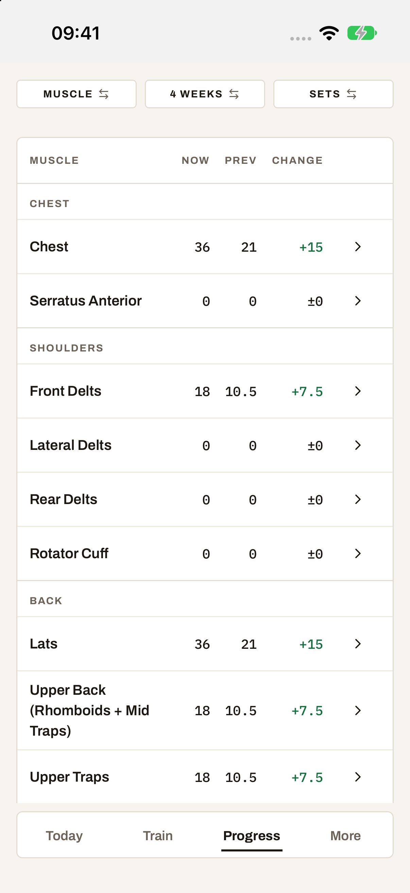
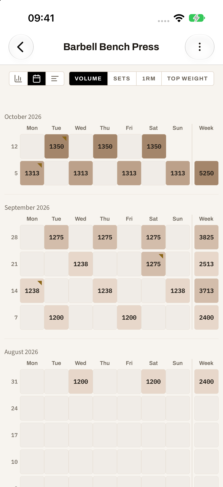
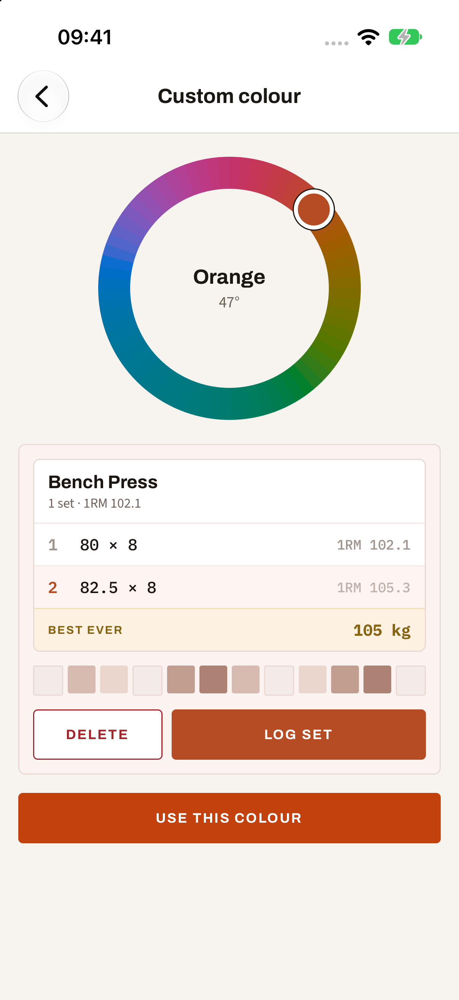
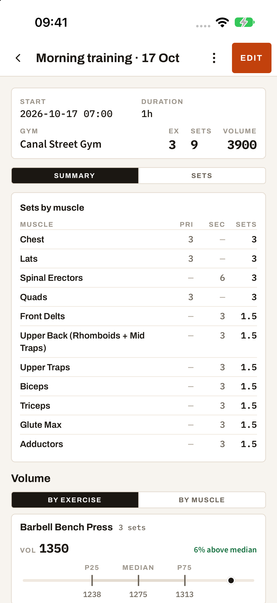

# BoGa

BoGa is a strength-training app for people who want to understand their training
and enjoy progressing together. It combines quick workout logging, detailed
analytics, adaptable training plans and private social groups in one mobile app.
Workouts save locally as you train and sync when you are connected.

## Analytics: understand the work behind your progress

BoGa connects individual sets to the bigger picture: how your strength changes,
where your training volume goes and how consistently you train.

- **Explore from overview to individual sets.** Compare training periods by
  exercise or muscle, then open the history behind the numbers. Calendar
  heatmaps, weekly views and timelines offer different ways to spot patterns.
- **See more than the weight on the bar.** Track estimated one-rep max, top
  weight, volume and personal records alongside muscle-level training load.
- **Put a workout in context.** Exercise comparisons show how a session relates
  to your previous training, while session summaries bring records and muscle
  work together.
- **Explore strength curves.** The experimental RM curve view lets you inspect
  the relationship between load, reps and effort, with filters for gym and time
  period. Its curve fitting is exploratory, without calibrated prediction or
  confidence claims.

## Flexibility and customisation: fit the app to your training

BoGa makes the exercise library, workout structure and analysis configurable,
so you can describe the way you actually lift.

- **Your exercise library.** Create and edit exercises, and map their
  primary and secondary muscles. Support for total-load or
  per-side entry and optional bodyweight contributions covers different ways
  of loading an exercise.
- **Plans without a rigid workout script.** Build session plans and programmes,
  start a planned workout or bring individual exercise blocks into a session
  alongside freeform training.
- **Control your analysis.** Adjust effort preferences, weekly muscle targets,
  progress periods and history look-back, with filters for browsing your data.
- **Make it yours visually.** Choose Warm, Slate, Forest or Plum, or pick a
  custom colour with a preview of the resulting interface.

A compatible AI coach can connect through BoGa's authenticated MCP service to
analyse training history. With a separate, explicit planning permission, it can
also create session plans and programmes for you to use in the app.

## Social features: turn shared training into friendly competition

BoGa's groups connect the training log to a shared record of progress, with
competition built around the exercises your group uses.

- **Private groups and shared activity.** Invite training partners with a group
  code, follow their workouts and browse shared sessions.
- **A common exercise language.** Link your personal exercises to group-defined
  exercises, keeping your own library while taking part in shared leaderboards.
- **Competition with accountability.** All and Certified leaderboards, witnessed
  record sets and record history give the group more than a list of scores.
- **Bodyweight-aware competition.** Groups can enable relative scoring while
  keeping members' bodyweight readings private.
- **Keep in touch with progress.** Optional iOS group workout notifications and
  shareable workout-summary images bring achievements beyond your own log.

## Screenshots

Captured from the iOS app with sample training data.

| Muscle progress | Exercise history |
| :---: | :---: |
|  |  |

| Custom colour | Workout summary |
| :---: | :---: |
|  |  |

## Working on BoGa

The mobile app uses Expo, React Native and TypeScript, with SQLite on the device
and Supabase for authentication, sync and group services.

- To run or debug the app, start with the [runbook](RUNBOOK.md).
- To understand or change the implementation, use the [specification index](docs/specs/README.md).
- Before contributing, read the [repository instructions](AGENTS.md).
