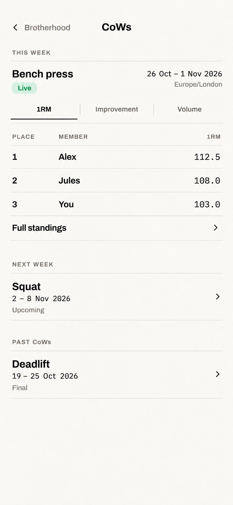
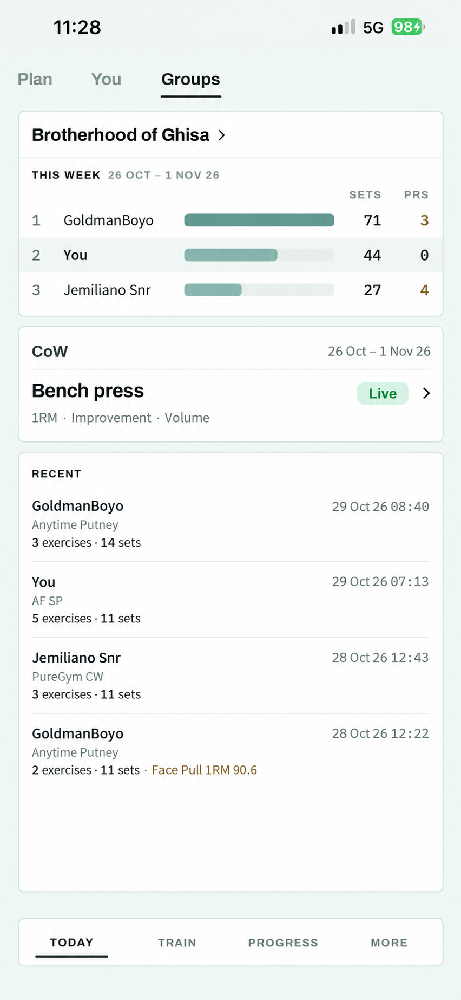
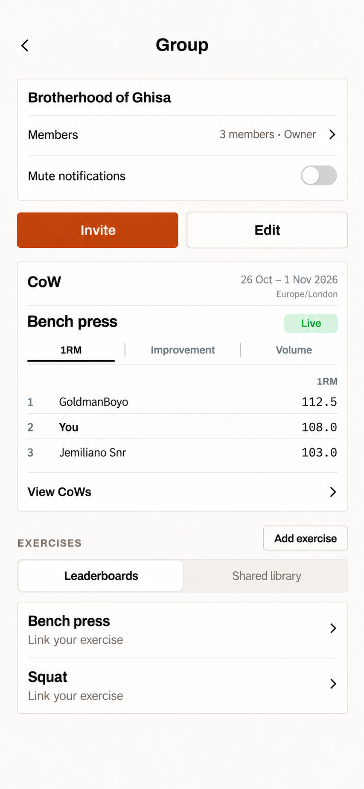
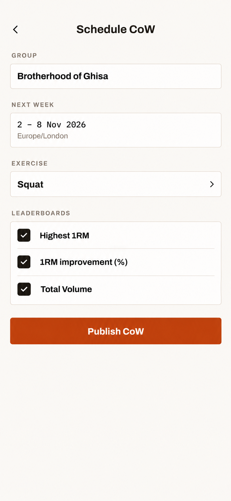
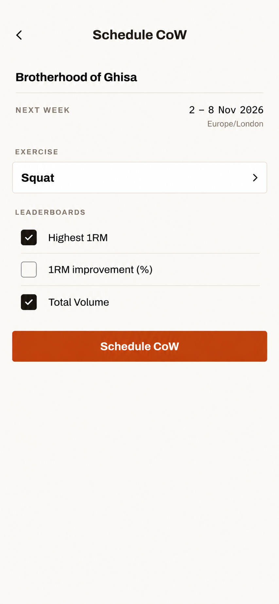
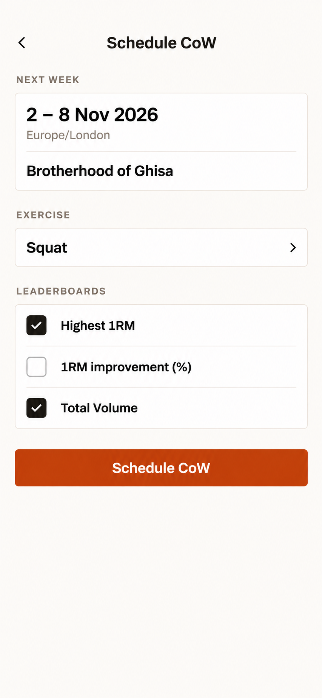
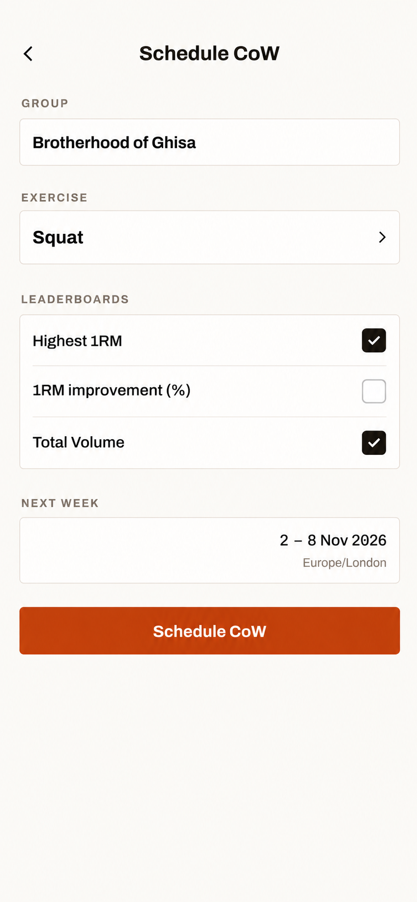
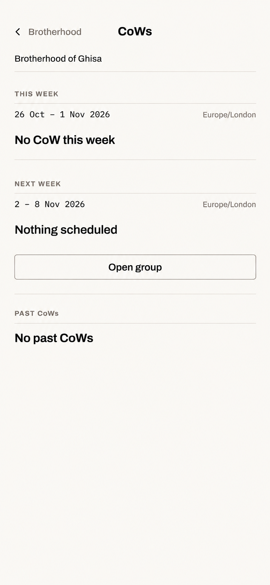
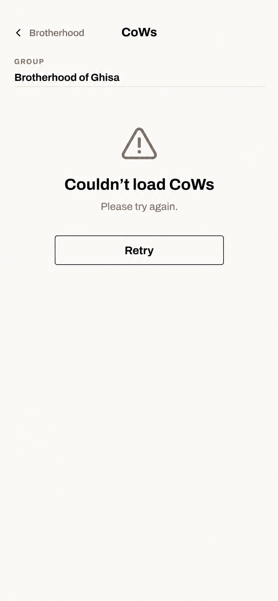

# CoW — UX brief

- Status: three attached mockups approved by the operator on 2026-10-29:
  detailed chronological browser with horizontal banner, and Today top-three
  card with in-card metric tabs, and the revised individual group-page preview.
  The last-week-final fallback on Today is also agreed. Scheduling alternatives
  and empty/error targets remain pending review. The group link's View CoWs
  versus View/Edit CoWs wording is explicitly deferred.
- Owner: [M39](milestones/M39-group-challenge-of-the-week.md), implemented by
  [T04](tasks/M39-T04-Deliver_CotW_mobile_flows.md).
- Authority: milestone D1–D9 for agreed product direction; remaining T01
  questions stay open. Agreed entry points are recorded below; remaining
  layout and interaction details are proposals.
- Implementation references: capture current Groups / At a glance, group
  management and comparison-form screenshots for the remaining flows, in the
  worktree's gitignored mobile artifacts tree. The approved generated mockups
  are design inputs, not running-app evidence or interaction-tested prototypes.
  The operator supplied the current Today / Groups reference screenshot.

## Approved browser target

The operator approved a chronological page with
This week, Next week and Past CoWs visible together. The current CoW has a
metric selector and top-three ranking preview, followed by Full standings;
upcoming and past CoWs are compact rows. No Current/Next/History tab bar or
week stepper on this browser.

Requested refinement: arrange the top current-CoW information horizontally
like the first concept, preserving the third concept's formatting. The
exercise and Live state sit left; dates and time zone sit right. Keep all
other sections, type, colours and figures unchanged. The attached revision is
approved as the member browser target.



Generated with the built-in image-generation tool. Prompt: edit the selected
chronological concept only, use the first concept solely for two-column header
alignment, retain the same date range/zone, and preserve all other content and
formatting. This image covers the member browser; the draft admin form
appears below.

## Intended outcome

An admin schedules next week's CoW in one short form. Every member can find
the exercise before it starts, follow each metric during the week, and read
the stored final outcome afterwards. Use CoW in feature names and copy, with plural CoWs; preserve that casing
even in controls whose surrounding labels use uppercase.

## Agreed placement and navigation

The operator clarified two distinct surfaces: the selected detailed browser
is accessible from Groups; when this week's CoW exists, Today / Groups shows
it in a separate small card for the selected group, using the agreed fallback
below when absent. The earlier At a glance summary
placement was a misunderstanding and is replaced by this distinction.

Today shows the current exercise, week, status and the first three places of
the selected leaderboard. Compact 1RM / Improvement / Volume tabs switch
between the enabled metrics inside the card; no navigation or swipe is needed.
Only metrics enabled for that CoW are offered. Render at most three qualifying
server-ranked rows with their correct unit; do not substitute the viewer for
third place or fabricate missing results. Keep the preview height stable when
switching to a metric with fewer results.

The header/chevron opens the detailed browser with the same group, displayed CoW
and selected metric. Metric controls stay independent of that link; the whole
card is not one nested press target. There are no upcoming/history rows or
admin actions. A prior result or next week's challenge must never be presented
as current. The authoritative group-calendar
window determines this card; the existing Today working-set board keeps its
own viewer-local week. No new main tab.

Approved placement: between Today's existing group week board and Recent.
Keep the group's existing header/switch and working-set board intact. Recent remains the
elastic, internally scrollable part; adding the small card must not push it
or the tab bar off-screen. Long names wrap without reducing type size.



Generated with the built-in image-generation tool. Prompt: refine the current
Today card with three metric tabs and the selected ranking's top-three rows;
retain the current exercise/week/status and header detail link. Preserve the
theme, type, existing working-set board and tab bar; consume Recent's spare
space, allowing its list to scroll. Both the behavior and attached layout are
approved. The full browser stays separate.

### Agreed: no CoW this week

The operator chose this priority: show the current group's current-week CoW
when it exists; otherwise show exactly the previous group-calendar week's
stored final CoW. Label the fallback Last week · Final with its actual dates,
retain top-three metric browsing, and open that displayed CoW/metric in detail.
If no authorized final outcome is available for that previous week, hide the
card entirely, with no placeholder or reserved space. Never search older weeks,
substitute an upcoming CoW, or show a stale Live/Finalizing result as final.

A current CoW with no qualifying scores still takes priority and shows its
existing no-results state; lack of scores is not lack of a CoW. At a week
boundary, re-evaluate selection and labels so the fallback cannot silently
become two weeks old. Use authorized stored results and their original units,
under the existing historical-disclosure policy; never recalculate the final.

Groups provides one full-width CoWs chevron row below its existing group
heading/filter controls and before the selected view's content. It opens the
secondary browser for the selected group, across At a glance, Stream and
Leaderboards. Keep the existing section selector unchanged. Show the entry
even when the group has no CoWs; do not show it without a selected membership.
It does not embed the browser or add another weekly summary card.

The individual group page contains a current-CoW preview with at least the
information shown on Today, plus a View CoWs link into the secondary page.
Members view/browse on that page; owners/admins also manage CoWs there and
open the creation/editing form from it. The group preview and Today have no
inline scheduling/editing controls. Keep the same selected group/CoW across
entries, and return Back to the page that opened the browser or form.

The secondary page uses the selected chronological browser for current/upcoming
CoWs and past results. Concrete route names remain for T04; creation/editing
must happen on a secondary page, not an inline Today form.

These are layout sketches, not pixel targets:

```text
Today: Plan | You | Groups
...existing selected group's header and week board...

CoW                         26 Oct – 1 Nov 26
Bench press                         Live   >
[1RM] | Improvement | Volume
1 GoldmanBoyo                         112.5
2 You                                 108.0
3 Jemiliano Snr                       103.0

...existing Recent sessions...

Groups
CoWs                                       >

Individual group page
CoW                         26 Oct – 1 Nov 26
Bench press                         Live
[1RM] | Improvement | Volume
1 GoldmanBoyo                         112.5
2 You                                 108.0
3 Jemiliano Snr                       103.0
View CoWs                                  >

Secondary CoW page
This week: current CoW and ranking preview
Next week: upcoming CoW
[Schedule next CoW / Edit next CoW] (admin only)
Past CoWs: final results
```

On the secondary CoWs page, the Next week section offers Schedule next CoW
to admins when that slot is empty, or Edit next CoW for an editable next slot,
subject to T01's lifecycle. Both open the separate form. The group-preview
arrangement below is approved; its onward-link wording remains open.
Browser/form date formatting follows the account preference; Today uses
[[copy.calendar-dates]]. CoW dates refer to the group zone on both surfaces.

## Group-page preview target — approved

The operator requires the individual group page to show at least the same
current-CoW information as Today. After Invite/Edit and before Exercises,
show exercise, week, status and the server's first three places, with the
same in-card enabled 1RM / Improvement / Volume tabs and correct units.
Include the group's time zone; dates follow this page's account preference.
Do not substitute the viewer for third place. A separate View CoWs footer
opens the secondary page for browsing and role-appropriate management,
retaining the displayed CoW and metric. Metric tabs stay independent of this
navigation target. Invite remains the group's sole primary accent. The
operator approved this layout; View CoWs is working copy, with View/Edit CoWs
left as an alternative to decide later. This does not grant edit access to members.

Proposed reuse: the preview follows Today's current-first, exact-last-week-final
selection. Unlike Today, the group page always retains its View CoWs entry
for a current member; when no preview is available, show a short empty state
beside that link. Loading/errors do not imply absence. Next-week scheduling
and edit controls live on the secondary CoWs page, not beside this preview.



Generated with the built-in image-generation tool. Prompt: extend the approved
browser/Today style into the current group management structure, preserving its
member/notification rows, Invite/Edit and exercise list; replace the bare link
and scheduling button with the approved Today preview's information and tabs,
plus a View CoWs footer. Keep the group theme. Grounding is the current source
and approved images, not a new running-app capture.

Back from the browser/form restores the opening page and selected group.
An Open group action in the browser opens this management page for that group;
returning restores the browser rather than changing the selected group.
Ordinary members never see the secondary page's admin actions. Show Schedule
only after the next-slot read confirms availability; unknown uses Loading…
or inline Retry. Do not add scheduling actions to Today or the group preview.
Use native chevron-only Back and house tokens at implementation; the generated
empty/error images inherit a short back label from the earlier browser reference,
which is not a new exception to the navigation contract.

## Schedule next CoW — pending review

From the group preview's View CoWs link, admins reach the secondary CoWs page;
its Schedule next CoW action opens the creation form. Next week's date range
and the group's zone are
read-only context, not editable date fields. Use the existing group
exercise picker; require at least one metric. The visible form is the review:
group, fixed week/zone, exercise and metric choices, followed by one scheduling
action. The current alternatives propose Schedule CoW as its label. No duplicate
Review card or extra confirmation screen.
Publishing immediately makes the upcoming CoW visible to members.



Generated with the built-in image-generation tool. Prompt: extend the approved
CoW style into one short admin form with read-only group/next-week/zone context,
the existing exercise picker, independent leaderboard checkboxes and one
Publish CoW action. The illustration shows a filled form, not a new rule that
all three metrics must be selected. This earlier Publish CoW draft is not
approved; the alternatives below are the current selection set.

### Scheduling layout exploration — pending selection

The three independent alternatives keep the same behavior: fixed group and
next-week dates/zone, one existing active group exercise, independently chosen
leaderboards and one Schedule CoW action. They vary context density, order and
checklist placement within the house style. No wizard, date picker, recurring
setting, extra review step or new exercise/scoring configuration.







Generated independently with the built-in image-generation tool, grounded in
the earlier form and approved group image. Prompts: compact context/checklist;
week-led read-only context block and grouped checklist; exercise-first choices
with a fixed-week strip before the action. Reference size 853 × 1844; date
anchor 2026-10-29, next week 2–8 Nov 2026 in Europe/London. Visible option
numbers follow their display order in the conversation. Squat and the two
checked metrics are a filled example, not initial defaults or a selection
requirement. All three remain unapproved until the operator chooses/refines one.

Editing reuses the same form and entered selections, titled Edit CoW with
Save changes as its primary action. Allowed fields/actions still follow
T01's lifecycle; the draft layout does not settle editing or cancellation policy.

```text
< Back                         Schedule CoW

2 – 8 Nov 2026
Europe/London

Exercise                          [Squat >]
Metrics
[x] Highest 1RM
[x] 1RM improvement (%)
[x] Total Volume

[Schedule CoW]                  (candidate copy)
```

No exercise exists: offer the existing group-exercise creation path to admins,
then return to the retained form. Group zone missing on an older group: require
an explicit admin zone choice first. Propose a zone control in existing group
management's Edit form, using a Time zone field and the existing picker
conventions, with the creator's device IANA zone as the new-group default;
never infer an existing creator's zone from another member's phone.

Editing an upcoming CoW reuses the form. Edit/cancel controls follow the
merged lifecycle contract. Destructive cancellation confirms. An occupied
slot or concurrent admin write preserves input and offers Open existing CoW.
An uncertain publish response refreshes before retry; it never creates a
second definition. If next week begins while the form is open, reject stale
dates and require review of the newly available next week before publishing.

## Standings, reporting and history

The detail page identifies group, exercise, week and zone; show metric
selectors only for the chosen metrics, and one ranking at a time. Reuse rank
rows. Keep attained 1RM in the group's unit distinct from improvement %.
Missing baseline is an unranked improvement state; other metrics remain
available. There is no combined winner or weekly certification action.

Upcoming: exercise, metrics and start date, with no ranking yet. Live: current
standings and end date/time. After the deadline: Finalizing until the server
returns its stored outcome. Final: the per-metric winner or tied winners and
the rankings, or No qualifying results. Tie presentation follows T01; never
invent an overall winner. A user's ineligible/not-yet-participating state is
visible without an enrolment control.

Today never labels an ended previous week's CoW as current; its agreed
explicitly labelled last-week fallback follows the priority above. Stored outcomes
live under Past CoWs in the detailed browser, newest first, with the same final
detail opened from there. Both Groups and the Today card can reach the browser;
admins manage from that secondary page and open the scheduling form there. This is persistent in-app
reporting, not a modal, a seen-once celebration or a push notification.
Final results never imply a drill-down source workout is still available.
Only provide permitted detail links that remain valid; hide unsafe historical
figures under current disclosure without inventing new winners.

## Empty and error targets — proposed

The browser keeps its This week / Next week / Past CoWs structure when
individual sections are empty. Only a successful authorized response proves
absence; a loading or failed read must never claim No CoW. Empty sections
carry one short state, no invented rankings or zero scores.





Generated with the built-in image-generation tool, independently per image.
Prompts: retain the approved chronological browser's visual language and group
context; show empty dated sections with one Open group action, or replace
unknown results with a plain StatePanel and outlined Retry. Date anchor:
2026-10-29; group zone Europe/London. These are complementary states, not
alternative designs or running-app evidence.

| Situation | Presentation and recovery |
| --- | --- |
| Browser section absent | This week: No CoW this week with dates/zone. Next week: Nothing scheduled with dates and one Open group action. Past: No past CoWs only after the history read succeeds. Keep other populated sections visible. |
| Current metric has no results | Keep exercise/week/status and enabled metric tabs; show No qualifying results in the ranking area. No podium, fake zero, viewer promotion or last-week substitution. Omit Full standings when that metric has no rows. |
| No improvement baseline / ineligible member | A personal Unranked state, with one reason: No pre-week baseline or Eligible next week, as returned by the server. Other members and enabled metrics remain available. No Join button. |
| Deadline passed | Finalizing until stored final results arrive. A final empty metric says Final plus No qualifying results. Neither processing delay nor unavailable figures may be labelled an empty successful result. |
| Initial read, no cache | Plain Loading… StatePanel; keep group context/Back usable. Today uses a compact loading line in its CoW position, not fabricated ranking rows. Automatic refresh stays silent once content exists. |
| Read fails, no cache | Couldn’t load CoWs / Please try again. / outlined Retry. A failed metric/history page has its own Retry; retain loaded sections and never show No past CoWs for a failed history read. Today uses a compact inline Retry in the CoW position. |
| Refresh fails beside permitted data | Retain that data and show the existing inline error with Retry. Never promote a cached lifecycle state to Final. Drop stale responses after group/metric changes. |
| Offline, permitted summary cached | Standard neutral Offline · last updated HH:MM marker; keep permitted context/top-three summary. Full standings and history remain online-only; show This loads when you're back online in their areas. |
| Offline, no cache | You’re offline / This loads when you're back online. No endless spinner, empty-week claim or queued write. Reuse this compact state on Today until a read establishes the agreed selection. |
| Confirmed lost group access | Replace all group/CoW content with the existing generic lost-access state; evict cached group results and hide Today content. No retained scores, form values or Retry that implies membership can be restored. Back remains available. |
| Incompatible or unavailable comparison | Safe Group comparisons unavailable state, not raw payload/errors or fallback kg figures. Retain only independently authorized safe context; follow T01/T03's revision/disclosure outcome. |

The agreed Today hide rule applies after a successful read establishes that
neither current nor the exact last-week-final fallback is available. Hiding
then leaves no gap. Network/read failures remain visibly distinct from absence.

Publishing failures use inline notices near the unchanged form's action:

| Situation | Presentation and recovery |
| --- | --- |
| Missing exercise or metrics | Choose an exercise. / Select at least one leaderboard. at the relevant field; focus the first invalid field. |
| No eligible exercise / missing zone | No group exercises yet with Add exercise, or Choose a group time zone with Open group settings; return to retained input and revalidate the fixed next-week window. Publish remains unavailable until resolved. |
| Offline before send | You’re offline. Nothing was published. Keep selections; refuse before sending. |
| Confirmed rejected write | Show the safe server refusal near Schedule/Save and preserve input. Role loss removes admin controls after refresh, while ordinary group browsing remains available. |
| Next slot occupied | Next week already has a CoW. Offer Open existing CoW; retain unsaved selections without overwriting the winner of a concurrent write. |
| Other state/revision conflict | Refresh and review the changed context with input retained; do not misreport every conflict as an occupied slot or silently overwrite another admin's changes. |
| Response uncertain | Couldn’t confirm publication. Offer Check status, which reads the authoritative slot before another create. While that read is failing or offline, keep create disabled; never assert Nothing was published. |
| Week rolls over during entry | Week changed. Review the new dates. Refresh the fixed next-week dates and require deliberate review/publish; never silently move the submitted challenge. |
| Confirmed success | Re-read and show the confirmed upcoming CoW on the secondary browser with neutral `CoW published.` feedback. Back from the form returns to that browser; further Back returns to the originating page/group. No second confirmation screen or automatic recurring schedule. |

## Review and implementation checklist

Reuse the existing group selector, Sheet/form primitives, rank rows, notices,
focus/poll/pull refresh and online-only writes. Preserve form input on errors.
Offline reads use only already-permitted cached summaries and the standard
last-updated marker; full rankings stay online under existing cache policy.
Loss of group access hides cached content. Distinguish loading, no CoW,
upcoming, live, finalizing, final-empty, final, unavailable and error+Retry.

Select/refine the scheduling target and review empty/error targets before implementation. T01
still owns cutoff, edit/cancel, ties and revision policy. Verify approved
layouts, state handling and fallback with
long names, small/large phones, keyboard/scroll, VoiceOver, touch targets and
non-colour state cues in the running app. T04's UX Contract owns the
flow/acceptance mapping; its PR supplies fresh running-app screenshots against
this accepted target. Delete this brief and its attached mockups with T04 and
the milestone.
