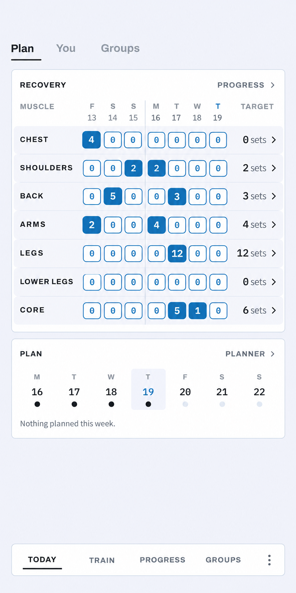
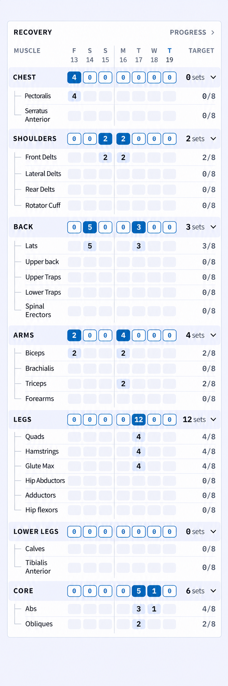
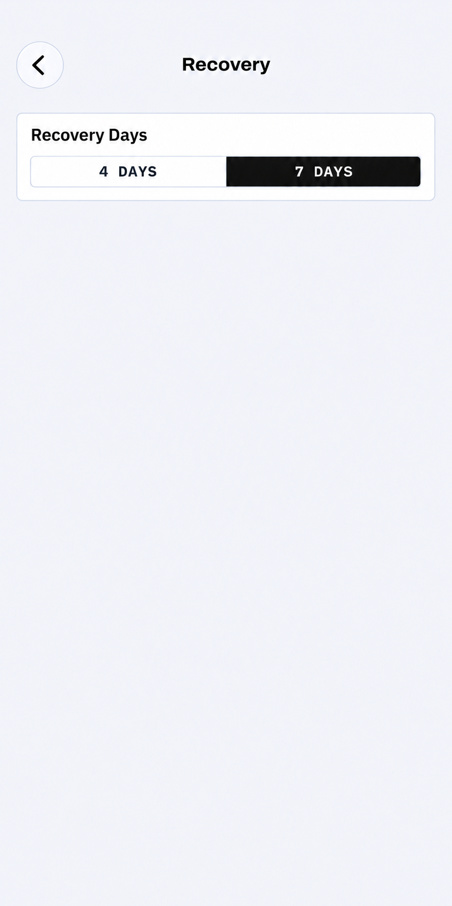

# Recovery: optional seven days

Plan for [issue #1239](https://github.com/Brotherhood-of-Ghisa/BOGA3/issues/1239).
This PR contains planning and visual targets only; it changes no application
behavior or accepted product fact. Delete this plan and its images when the
implementation ships, moving durable decisions to their owning facts/specs.

## Requirements

- **The default is four days**, for both new and existing profiles without a
  valid saved choice: three previous local calendar days plus today.
- The optional seven-day view is **six previous local calendar days plus
  today**, never eight columns. Oldest day is leftmost; today is rightmost.
- Put the choice in **Settings → Training → Recovery**. The Settings
  destination is `Recovery`, its page title is **Recovery**, and the label
  immediately above the selector is **Recovery Days**. The options are
  **4 days** and **7 days**, drawn using the existing control's casing.
- Save immediately through the existing account-scoped, device-local
  preference store. Restore the choice after relaunch/account switches;
  another account and local-only use have their own choices. Missing or
  invalid storage falls back to four days. No sync/schema migration.
- Use the selected **compact table**: names left, daily cells in the middle,
  weekly totals/targets right. Keep all columns aligned across family headers
  and children, wrapping long names without losing their full accessible name.
- The selected period affects Recovery only. Calendar-week totals still use
  Monday through today, including eligible work in progress; set eligibility,
  targets, reporting/combining, and secondary-set choices retain their rules.
- Retain the existing ordering algorithm: target attainment and weekly sets
  first, recent work as its tie-break, then muscle order. That recent-work
  tie-break uses the selected Recovery window; extending the window may change
  tied rows, never the weekly totals themselves.
- Retain per-family expand/collapse, initially collapsed; muscle rows open
  their existing history. Expanded families retain numeric daily sums, including
  zero; individual-muscle days without work stay blank. No expand-all control.
- Keep today's accent label, the Monday boundary when both weeks appear,
  weekly targets, the Progress link and the lower Plan card. No period selector
  on Today, new period presets, horizontal scrolling, or unrelated restyling.

Existing counting/display contracts: [[set.eligibility]], [[muscle.set-count]],
[[muscle.report-groups]], [[muscle.weekly-targets]], [[copy.blank-history]].

## Visual target and UX contract

The user selected the first generated concept: the compact seven-day table.
The corrected Settings wording above governs any image ambiguity. These are
AI-generated design targets, not screenshots of implemented or tested behavior.
They use illustrative data anchored to Thursday 19 November 2026; the product
uses the current local date. Numeric examples and anatomy do not override the
existing rules or the account's actual enabled/combined muscles.

### Recovery, families collapsed — selected layout

### Recovery, all families expanded — full scroll content

This extends the selected layout to all seven families and 25 enabled,
individually reported example muscles. It is a tall capture of the full
content, **not a larger phone viewport**: the existing Recovery card scrolls
internally and the Plan card remains below it. Expanding a family never reveals
anatomy hidden inside a combined muscle ([[muscle.no-breakdown]]).

### Settings → Training → Recovery

The mock illustrates seven days selected to match the Today examples;
**four days remains the default**. Reuse the existing Settings `SubPage`,
`FormSection` and `SegmentRow`, not a new settings widget. Recovery remains a
custom composition derived from the existing Recovery table; this task does
not migrate it to a different table family or add a reusable template.

| Trigger | Steps and success | Failure/edge outcome |
| --- | --- | --- |
| Change period | Open Settings, find Recovery under Training, choose 4 or 7 days; save immediately; return to Today and read that window. Settings' destination summary shows the stored day count. | A failed save keeps the durable value and existing inline error/retry behavior; no false successful selection. |
| Read changed window | Re-read Recovery when the saved preference changes; headers, cell arrays and spoken dates come from the same loaded model. | Rapid switches/account changes cannot let an older response replace the latest model. Keep the previous model while refreshing; retain existing read failure/retry behavior. |
| Expand family | Tap a header to show its reported muscles; collapse only that family on the next tap; child taps open history. | Many expanded rows scroll inside the card; long names wrap; no hidden or clipped target/day values. |
| Date rollover | Re-read on focus, foreground return and local midnight; use calendar arithmetic through DST, month/year and week changes. | A Monday total excludes the preceding weekend even when those days remain visible. |

Validate the selected compact arrangement at the project's small and normal
iOS sizes, with long names, grouped/ungrouped content, all families expanded,
fractional contributions and large counts/targets. Keep the established font
scale and control/accessibility behavior. If the compact layout cannot fit,
report the conflict before changing the chosen arrangement or hiding values.

## Implementation scope and sequence

1. **Preference and Settings.** Extend the type/default/validation in
   `apps/mobile/src/preferences/model.ts` with a numeric `4 | 7` displayed-day
   choice, default `4`; reuse generic storage/update behavior. Add a Recovery
   settings presenter/screen, Training destination and stored-value summary.
   Follow the sibling route pattern in `apps/mobile/components/settings/sub-pages.tsx`,
   `apps/mobile/app/settings.tsx`, `apps/mobile/src/navigation/routes.ts` and
   `apps/mobile/components/navigation/root-stack.tsx`; cover route registration
   and exact title/selector wording. Proposed route: `/settings-recovery`.
2. **Window and repository.** Parameterize `todayPlanWindow` in
   `apps/mobile/src/today-plan/calculations.ts`, passing the displayed-day
   choice through `TodayPlanOptions` in the repository and public exports.
   Preserve the four-day default for existing callers, including coaching
   parity and synced-target tests. Read from the earlier of the Recovery
   start and this Monday, through tomorrow's local midnight; reuse the daily
   aggregation rather than introducing another query/calculation path.
3. **Refresh and rendering.** Pass the durable preference through
   `apps/mobile/components/today/use-today-plan.ts` and its read dependencies;
   preserve its generation guards and existing refresh triggers. Adapt
   `apps/mobile/components/today/plan-cards.tsx` for both column counts across
   headers, family sums and muscle rows, preserving alignment, blank-vs-zero
   semantics, accessible dates/counts and navigation. No new dependencies.
4. **Tests and durable documentation.** Extend the existing suites below.
   In the implementation PR, update **comparison.allowed-periods** to cover
   the configurable four/seven-day Recovery period and explicit default.
   Update the affected Today/Settings inventory and ownership summaries in
   `docs/specs/ui/screen-map.md` and `docs/specs/09-project-structure.md`.
   Highlight that product-fact change in the implementation PR; this planning
   PR deliberately leaves current facts/specs unchanged.

## Acceptance and verification

- Extend `apps/mobile/__tests__/progress-preferences.test.ts` for default 4,
  both valid choices, invalid/missing storage, failed writes, relaunch and
  account/local-only isolation. Extend the existing Settings screen/route
  suites for the Training destination, current-value summary and exact copy.
- Extend `apps/mobile/__tests__/today-plan-calculations.test.ts` for 4/7
  columns, oldest-first local dates, DST and week/month/year boundaries,
  unchanged weekly totals, selected-window tie-breaks and family sums.
- Extend `apps/mobile/__tests__/today-plan-screen.test.tsx` over real migrated
  SQLite: older work appears only in seven-day mode, switching both ways,
  expanded families/long names, targets/spoken dates, existing navigation,
  midnight refresh and stale-result/read/save failures. Read each test
  directory's README before editing; mock only states real data cannot produce.
- Run `./boga test for` on the finished implementation. Expect `fast` plus
  UI defaults; root-stack registration also selects `frontend` on macOS.
  Agree any justified reduction with the reviewer before running beyond
  `fast`. Run the smallest relevant existing Maestro lanes and capture native
  small/normal comparisons for both periods and collapsed/expanded states.
  Do not add a Maestro toggle scenario where Jest proves the behavior.
- Run `jest-coverage`, `complexity` and `dependencies` once on the finished
  implementation; retain all existing thresholds and shrink-only baselines.
  No native dependency/config change or forced client rebuild is planned.
- Complete code and product reviews, open the implementation PR with evidence,
  and delete this plan and its three mock assets when the work ships.

This PR's verification is separate: documentation/assets only, with no claim
that the proposed UI or behavior has been implemented or device-tested.
