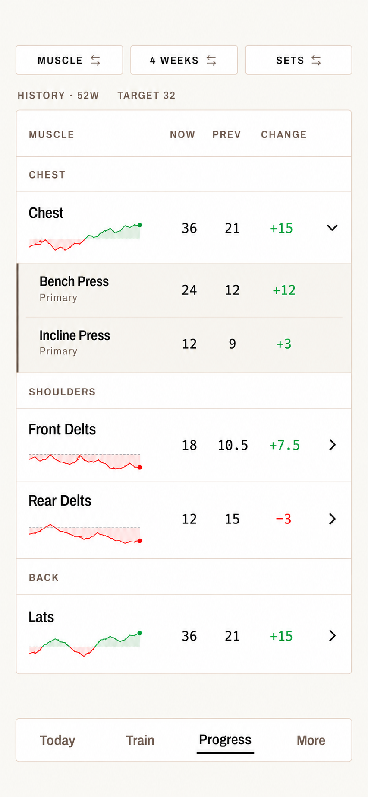

# T-20261023-01 — Muscle history tickers in Progress List

- Status: `planned`; visual design approved by the product owner on 2026-10-23.
- Depends on: none. Milestone: none.
- Areas: frontend and local derived analytics; UI impact: yes.
- Planning attribution: OpenAI Codex; approved image generated with ImageGen.

## Objective and exact screen

Add compact historical stock-style tickers to **Progress → List → Muscle**, for
Sets and Volume. Apply only when the Progress layout preference is `list` and
the breakdown is `muscle` on `/progress`.

The layout is selected through **Settings → Progress → Progress view → List**;
there is no new List/3D selector to add to Progress. Leave **Progress → 3D** and
its Contributions panel unchanged. Also leave Map/heatmap, the Exercise
breakdown, exercise contribution rows, and the separate history screen unchanged.
No chart appears on an exercise row, even inside an expanded muscle.

## Approved design target

The owner approved the following final mock: **option 1 placement**, **option 2
line styling**, narrowed to at most one-third of the enclosing table's width.
This supersedes the earlier wider charts, intermediate observation dots, and
earlier proposals to plot only the latest four weeks.

The PNG is an approved design input with illustrative values, not a runtime
asset or a specification of current product data. It travels with this
ephemeral task under `docs/plans/`; delete both the card and its PNG when the
work ships. Keep implementation screenshots and visual comparisons in the
gitignored `apps/mobile/artifacts/` tree.

For design authority and screenshot evidence, load
`docs/specs/ui/ai-design-policy.md`. The mock governs ticker placement, compact
proportions and styling. Current repository code governs existing controls,
tokens, data rules and accessibility: preserve current search, gym selection,
grouping and sorting even though the mock does not show all of them.

## Decided behavior

### Geometry and appearance

- Place a small ticker **beneath each muscle name**, within the name area.
  Preserve aligned Now / Prev / Change columns and the separate contribution
  chevron. Do not move the chart to a right-hand column or across the row.
- The complete plot, reference line, fill and endpoint marker must fit within
  **one-third of the actual enclosing table/panel width**. Measure that
  container, not the screen. This is a cap, not a required width: the plot can
  be shorter for limited history. A longer history never widens the chart.
- Use a thin connected line with restrained filled areas between the line and
  its reference: green above, red below. Split both line and fill precisely at
  reference crossings. The reference is the relative zero, not zero training.
- Show only **one dot at the latest available observation** per chart. No
  intermediate, starting or crossing markers. Do not fabricate a point at today
  when the latest valid observation is earlier.
- Retain the light dashed reference and BoGa typography, surfaces and semantic
  colors. No bars, extra chart controls, per-point labels or chart tap targets.
  Literal `52W`, `4 weeks` and `32` in the mock are examples, not constants.
- Preserve name/history navigation, chevron disclosure, focus restoration and
  minimum touch targets. Family headings and contributors get no tickers.

### Time span versus rolling period

Keep these three concepts independent:

| Concept | Source and behavior |
| --- | --- |
| Visible history | Settings' `historyLookbackWeeks`, through today; reuse the established history-window bounds. Fit this whole time span into the compact plot. |
| Value at each observation | Rolling total over Settings' `targetWindowWeeks` (**N**, commonly 4), not a cumulative total from the chart's start. |
| Table comparison | Existing selected N-week / This week behavior for Now / Prev / Change. |

Selecting **This week** changes the table comparison, not the chart's history
extent, rolling N or reference. Read up to N additional weeks **before** the
visible start where needed to calculate its first rolling observation; those
extra weeks do not extend the visible chart. Limit the visible extent to the
configured history and available valid history; never invent older readings.

### References and data

- **Sets:** reference = configured weekly working-set target × configured N.
  It stays that full-period target when This week is selected.
- **Volume:** reference = that muscle's historical median of comparable
  N-week Volume totals over the history look-back, not a median of weekly
  values compared with an N-week total. Resolve the exact sample policy below.
- Color describes above/below this reference. Existing signed Change describes
  current versus previous table periods; its color may legitimately differ
  from the chart's endpoint color.
- Derive readings locally using the existing personal effort policy, muscle
  mappings and current gym scope. Keep missing/unavailable/rest distinct from
  known numeric zero. Do not bridge missing observations with invented data.
- Reuse existing analytics; no schema, sync, server, persisted achievements,
  new settings or charting dependency is requested. Avoid a separate database
  query per row/observation when a bounded shared read can supply the series.

## Open — settle before implementing calculations

Visual approval does not choose the following numerical details. Present a
small concrete proposal to the owner rather than silently creating a fact:

1. Observation cadence and exact rolling boundaries: daily/weekly/event-based
   samples, trailing N full weeks versus an N-calendar-week window, local-time
   boundaries and handling of the current partial week.
2. Volume median population: overlapping rolling observations versus distinct
   comparable periods, inclusion of partial/zero/rest observations, minimum
   sample and behavior when no valid reference exists. Do not reuse the weekly
   reference policy as if it already governed this new N-week ticker.
3. Precise proportional shortening/alignment for limited history and treatment
   of zero or one valid observation. The one-third cap and truthful missing-data
   presentation are already decided.

## Implementation entry points

Recheck these against current main before editing:

- `apps/mobile/app/(tabs)/progress.tsx` — screen filters, gym and breakdown.
- `apps/mobile/components/stats/progress-muscle-view.tsx` — its
  `muscleLayout === 'list'` branch renders `ProgressTables`; keep chart data and
  UI scoped there. Other branches render 3D/Map and shared contributors.
- `apps/mobile/components/stats/progress-tables.tsx` — `MuscleRow` is the
  intended insertion point. `ProgressContributionRows` is shared with spatial
  views: do not put tickers there or in `ExerciseRow`.
- For data work, load `docs/specs/tech/training-metrics-contract.md` and inspect
  `apps/mobile/src/data/stats.ts`, `muscle-analytics.ts` and the existing history
  readers before choosing the smallest shared derivation.
- For calendar math and settings, inspect
  `apps/mobile/src/utils/calendar-weeks.ts` and
  `apps/mobile/src/preferences/model.ts`; preserve their established contracts.

## UX contract and acceptance

| Flow | Success | Failure / edge |
| --- | --- | --- |
| Open Progress List with Muscle / Sets | Under-name rolling tickers, configured target, width ≤ panel / 3. Existing figures and controls remain usable. | No history or read failure cannot fabricate zeros or prevent reading the existing table. |
| Switch Sets / Volume | Correct series, reference and accessible numeric description; no stale series from the other metric. | Missing/invalid median follows the agreed policy without claiming above/below a nonexistent reference. |
| Select This week | Table figures update; the ticker's span, configured rolling N and reference remain unchanged. | No accidental one-week series or target. |
| Change history setting, target, gym or underlying training | Readings refresh from the same applicable scope and current policy. Long history remains within the width cap. | Short/sparse history and asynchronous responses remain truthful and do not show another gym/account's stale data. |
| Expand contributors / open history / return | Existing independent controls and focus/scroll behavior are preserved; contributors have no chart. | Narrow phone and long names do not push numeric columns or chevrons off-screen. |
| Open Exercise, Map or 3D | Existing presentation; no new ticker, including 3D Contributions and any fallback exercise List. | No chart-related reads mounted solely for these excluded views. |

Provide accessible text identifying the metric, rolling period, reference and
latest valid value without relying on color alone. Reuse the existing row
navigation instead of adding a separate focusable chart control.

## Verification, specs and handoff

- Before editing tests, load their directory README. Extend meaningful Jest
  coverage for rolling/boundary/reference cases, crossing colors and endpoint
  markers, width cap, This week independence, gym/settings changes and absence
  on all excluded surfaces. `stats-screen.test.tsx`,
  `stats-screen-local-data.test.tsx` and the progress comparison suites are
  starting points, not a mandate to duplicate coverage.
- Capture the running app at small and large phone widths for Sets, Volume,
  This week, expanded contributors and sparse/error history; compare with this
  approved mock and record material deviations. Explicitly verify unchanged
  3D Contributions and Exercise views.
- Run `./boga test fast`. For implementation the UI path default is
  `frontend-ui` on macOS / `frontend-android` on Linux; propose the smallest
  relevant lane set and get operator agreement before slower lanes. New
  Maestro flows require separate justification and approval. Run the quality
  targets before the implementation PR per AGENTS.md; do not treat this card
  as prior agreement to a slow lane set.
- Once the open calculation rules are approved, record their durable facts in
  `docs/product/comparison.md` or the appropriate existing owner. For changes
  there, first load `docs/procedures/product-facts-authoring.md`. Update the
  training-metrics contract and UI screen/component documentation where the
  implementation changes their owned rules. Do not redefine existing history,
  comparison or muscle-count facts incidentally.
- Follow the optional task protocol in `docs/plans/README.md` if executing this
  as one task / session / worktree / PR. Delete this card when its work ships;
  keep review and gate evidence in the PR. Do not reference this task ID/path
  from production code, tests or persistent specs.
