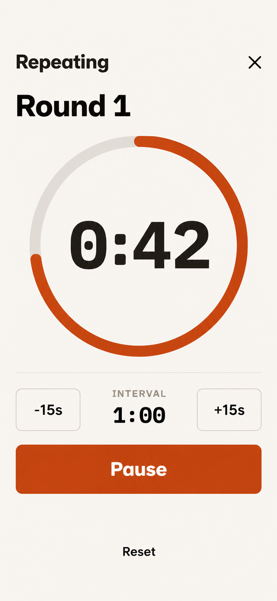

# T-20261024-01 — Repeating timer: clarity, cues and screen awake

- Status: `planned`
- Depends on: none
- Milestone: none
- Areas: frontend; UI impact: yes
- Owner approvals: Design 3, Pause/Resume, round beep sequence and foreground keep-awake, confirmed in this planning conversation on 24 October 2026.
- Planning attribution: Codex, GPT-6 family; exact model variant unavailable. Current implementation inspected at `96826872`.

## Objective

Make the repeating/EMOM timer readable at a glance and easy to pause mid-workout. Apply approved Design 3, add audible warning and round-start cues, and keep the screen awake while the repeating timer is running in foreground BoGa.

## Scope

- In: fullscreen layout; matching Pause/Resume labels and accessibility names in both presentations; shared cue scheduling and native sound playback; foreground keep-awake lifecycle; existing Jest coverage; visual and real-device verification.
- Out: ordinary Rest timer changes, backend/sync/schema changes, sound-settings UI and guaranteed delivery while manually locked or backgrounded. Keep-awake does not unlock a phone or bypass authentication.

## Decided

1. **Design 3 is the visual target**, the third displayed proposal approved by the owner. Preserve BoGa's existing tokens, fonts, primitives and accessibility; the generated image guides layout rather than overriding repository contracts.
2. Show prominent, high-contrast `Get ready` / `Round N` **above the clock**. The progress ring contains only the large countdown. Below it: interval controls, a wide primary action, then a separate low-emphasis Reset at the bottom, clear of the safe area.
3. Running action is **Pause**; paused action is **Resume**, replacing Stop/Start in fullscreen and the compact strip, including accessible names. Keep one primary action. Enlarge the fullscreen button for easy one-handed use; derive its dimensions from existing tokens.
4. Keep the existing **15-second preparation**. Before **every** round, including Round 1, play a short beep at −5, −4, −3, −2 and −1 seconds; play a **sixth, distinctly longer beep at 0**, exactly as the round starts. Do not add time to the interval for the long beep.
5. Keep the screen awake while the repeating timer prepares/runs and BoGa is foregrounded, whether fullscreen or compact. Pause, timer dismissal, switching out of repeating mode, session end or backgrounding releases the request; Resume/foregrounding reacquires it if still running. Collapsing fullscreen alone does not release it.

## Approved design target

This local generated image is the approved build input, not a screenshot of shipped behavior. Keep it beside this card and delete both when the implementation ships. It depicts Round 1, 0:42 remaining, interval 1:00 at a 390 × 844 content target. Preparation and paused states use the same structure. Verify short-phone fit, correct progress fraction, long round numbers and 10:00; snap mock geometry and type to house tokens.

## UX contract

| Flow | Trigger and steps | Success | Failure / edge |
| --- | --- | --- | --- |
| Prepare and repeat | Select Repeating; display preparation; enter Round 1 and continue repeating | Phase sits above clock; five short cues then one long cue at each boundary; foreground screen stays awake | No beep before −5; no duplicate cue from multiple hosts; figures and controls fit small phones |
| Pause / Resume | Tap Pause during preparation, a round or a playing tone; wait; tap Resume | Freeze fractional elapsed time, silence playback and release keep-awake; Resume continues the same timer | No reset, replay of emitted warning seconds or overlapping tones; handle rapid taps |
| Reset / adjust interval | Tap bottom Reset or ±15-second interval control | Restart 15-second preparation, preserving paused/running state; keep the selected interval within existing bounds | Cancel obsolete cues; paused Reset remains silent until Resume; disabled interval limits remain correct |
| Expand / collapse | Expand from session or exercise host, then close/reopen | Same shared countdown, phase, pause state, sound schedule and foreground keep-awake | Close, Back and accessible escape only collapse; no second clock or sound player |
| Lifecycle / playback failure | Background, manually lock, return, interrupt audio or fail playback | Preserve correct time arithmetic and release/reacquire resources appropriately | No burst of missed beeps on return; audio failure cannot freeze or reset the timer; no promise of locked/background playback |

Appearance/accessibility: reuse house controls; neutral secondary Reset; at least 44pt touch targets; accessible paused state and focus restoration; countdown readable on demand without announcing every tick.

## Acceptance and implementation boundaries

- With preparation starting at t=0, short beeps occur at t=10…14 and the long beep/Round 1 at t=15. At a 60-second interval, the next shorts are t=70…74 and Round 2 begins at t=75. Test first and later boundaries with a deterministic clock.
- Retain the existing single shared store, drift-free round arithmetic, boundary vibration, ±15-second adjustment and 15-second-to-10-minute limits. Reset/adjustment preserves paused state; collapse never resets or pauses.
- Store/timer lifecycle owns cues independently of view mounts. Schedule against the shared timeline, deduplicate events, preload local tones, and cancel outdated callbacks/playing audio after Pause, Reset, adjustment, dismiss, mode switch or session replacement.
- Reuse an existing suitable native facility; otherwise select the smallest SDK-compatible audio dependency. `expo-keep-awake` is transitive in the current lockfile but is not a declared direct app dependency or used in app code: verify native availability and declare it directly if imported. Do not tie keep-awake solely to the fullscreen modal or duplicate ownership across hosts.
- Use temporary idle-sleep prevention, not global Auto-Lock settings. Manual locking and authentication remain intact. An unattended already-unlocked phone remains accessible longer; iOS power management may override the request. Validate on hardware, including power-saving settings.

## Open — resolve with the owner before audio behavior is finalized

- Silent-switch behavior and interaction with music/other audio. Exact short/long tone duration, pitch and loudness can be tuned on hardware; the accepted requirement is five short, one long, correctly timed and clearly distinguishable.
- Guaranteed locked/background sound is not approved scope. If required, agree the additional native delivery work explicitly; keeping the foreground screen awake does not supply it.

## Files to inspect / update

- `apps/mobile/components/session-recorder/repeating-timer-focus.tsx` — approved fullscreen hierarchy, controls and states.
- `apps/mobile/components/session-recorder/rest-timer-bar.tsx` — matching compact copy/accessibility and host integration.
- `apps/mobile/src/session-recorder/rest-timer.ts` — shared timer scheduling, cancellation and state transitions; round cues currently vibrate only.
- `apps/mobile/app/session/[sessionId]/index.tsx`, `apps/mobile/components/exercise-page/exercise-page-screen.tsx` — both timer hosts.
- Before editing tests, load `apps/mobile/__tests__/README.md`; extend `apps/mobile/__tests__/repeating-timer-focus.test.tsx`, `apps/mobile/__tests__/rest-timer-bar.test.tsx`, `apps/mobile/__tests__/rest-timer.test.ts`.
- Inspect `apps/mobile/package.json`, `apps/mobile/package-lock.json` and `apps/mobile/app.config.ts` if native support/dependencies need changes. Put intentional audio runtime assets with the mobile app; do not introduce a parallel generated implementation.

## Specs and handoff

Before implementation, load the AGENTS.md always-load/UI references, particularly `docs/specs/08-ux-delivery-standard.md` and `docs/specs/ui/ai-design-policy.md`. If screen behavior documentation changes, update its owner in `docs/specs/ui/screen-map.md` and component comments/tests. If new durable product facts are needed, load `docs/procedures/product-facts-authoring.md` and record only owner-approved decisions. Do not put the design target in persistent specs.

Execute in one leased local worktree. This card is planning only; do not implement from the planning branch. Under the task protocol in `docs/plans/README.md`, land the planning card before starting the implementation session, then delete the card and target in the implementation PR. Put test results and comparison screenshots in that PR's evidence.

## Gates and evidence — proposed, not run or agreed

- Run `./boga test for` for the implementation diff. `./boga test fast` is required for code changes. Propose the slower lane set to the owner before running it; macOS UI default is `./boga test frontend-ui`, narrowed only with agreement to flows that exercise the change.
- Extend Jest coverage for labels, phase/layout structure, first/later beep sequences, fractional pause/resume, duplicate hosts, cancellation, stale callbacks/no catch-up bursts, playback failure and keep-awake acquire/release.
- Compare selected target with fresh small/large-phone captures of preparation, running and paused states. Verify VoiceOver, Back/collapse, safe areas and interval bounds.
- On physical iOS hardware, verify cue audibility/timing, the agreed audio interaction policy, automatic sleep prevention and release, manual lock and power-saving behavior. Jest and simulator screenshots cannot prove these.
- Before an implementation PR, run `jest-coverage`, `complexity` and `dependencies` through `./boga test` after lane agreement, plus product/code review. Native dependency/config changes require the applicable client rebuild and platform lane per AGENTS.md. Add no Maestro flow without owner approval and a device-only justification.

Capability references for implementation: [Apple idle-timer API](https://developer.apple.com/documentation/uikit/uiapplication/isidletimerdisabled), [Expo KeepAwake](https://docs.expo.dev/versions/latest/sdk/keep-awake/), [Apple DTS on power-management overrides](https://developer.apple.com/forums/thread/815962).
