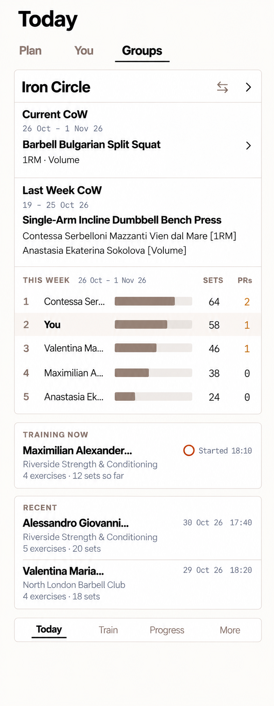

# T-20261030-01 — Show current CoW and last week’s winners on Today

- Status: `planned`
- Depends on: none; existing CoW lifecycle, scoring and mobile flows are implemented.
- Milestone: none
- Areas: frontend; backend only if the bounded read needs extending. UI impact: yes.

## Objective

Update **Today → Groups**, not My groups or the Groups screen’s standings,
to show the current Challenge of the Week and the previous group week’s winners.
A user sees the active challenge immediately and opens its details in the
group’s CoW flow. Keep the existing This week board, Training now and Recent
layouts and behavior unchanged.

## Accepted design target

User-approved Product Design mockup, 30 October 2026:

This attached, unmodified generated mockup is the build input for the CoW
sections’ content, order and grouping. It lives with this ephemeral card at the
user’s request. Its names, dates, exercises and results are examples. Existing
repository components govern the weekly board and session sections; incidental
generated differences in those sections are not permission to restyle them.
Do not edit the target to match implementation. Delete card and attachment when
this work ships; retain implementation evidence in the PR.

## Decided scope

- Below the group header and above the existing weekly board, add two compact
  sections within the group summary card, separated by hairlines. Exact titles:
  **Current CoW** and **Last Week CoW**.
- Current CoW shows its date range, exercise and **all enabled metric labels**
  together, for example `1RM · Volume`. No participant names, rankings, scores,
  metric switcher or podium in this section. The whole section is one accessible
  link with a chevron into the displayed challenge’s details for that group.
- Last Week CoW shows its date range, exercise and authoritative winner for each
  enabled metric. One winner/metric per row, formatted `Participant [metric]`.
  The bracket contains the metric label, not a score. A participant winning
  multiple metrics can occupy multiple rows. Do not select a single metric tab.
- Participant and exercise names stay on **one line**. Use available width and
  tail ellipses for overflow; never wrap or shrink the font. Keep the bracketed
  metric visible immediately after the participant name, not in a detached
  right-aligned column. Accessibility retains full names and metric labels.
- Include `Contessa Serbelloni Mazzanti Vien dal Mare` in fixtures and visual
  verification, plus long exercise names and multiple enabled metrics. Support
  every existing enabled metric, including Improvement, not only the mock’s two.
- Preserve group selection, board counts/bars, session links, tokens and existing
  typography. No scoring, eligibility, finality, calendar or scheduling redesign.

## Freshness and implementation notes

Checked against `origin/main` at `9c19ef94` on 30 October 2026. Today currently
renders `CoWGroupPreview` after its weekly board. That shared preview displays
one result with metric tabs and a podium; other surfaces also use it. Scope the
new summary to Today so group management, CoWs browsing and full standings are
not inadvertently changed.

`useCoWSummary` currently receives **current OR previous final**, not both.
Resolve the smallest authorized read that supplies both weeks together; do not
build two sections from that single fallback result. Reuse existing readers,
rankings and navigation before considering a bounded-reader extension. Any
extension must preserve exact wire validation, account/group cache isolation,
server selection/expiry, publication identity and current disclosure.

For implementation, inspect these existing files:
`apps/mobile/components/today/group-card.tsx`,
`apps/mobile/components/groups/cow-group-preview.tsx`,
`apps/mobile/components/groups/cow-preview.tsx`,
`apps/mobile/src/groups/use-cow-summary.ts`,
`apps/mobile/src/groups/cow-wire.ts`,
`apps/mobile/src/groups/cow-presentation.ts` and
`apps/mobile/src/navigation/routes.ts`.

## Open at implementation start

- Settle absent, valid-empty, finalizing and unavailable presentation for each
  week. Never invent a winner, promote a suppressed result, label a non-final
  result as a winner, or substitute an older week for Last Week CoW.
- Confirm the narrowest existing route that opens the displayed challenge’s
  details in the selected group’s CoW flow, and any reader/API work needed.

## UX contract and acceptance

| Flow | Trigger and steps | Success | Failure/edge |
| --- | --- | --- | --- |
| Read challenge | Open Today → Groups; pick a group. | Current exercise and all active metric labels, with no current leaderboard. | Existing loading/offline/retry behavior; no results from a previously selected group. |
| Open details | Tap Current CoW. | Opens that exact challenge in that group’s CoW flow; normal back returns to Today. | Missing or lost access uses existing handling; never opens another challenge. |
| Read winners | Read Last Week CoW. | One authoritative winner/metric per row from the immediately preceding group week. | Distinguish absence, empty, finalizing and unavailable; no inferred finality or promoted winners. |
| Long content | Use long exercise/participant names and multiple metrics. | Single-line text, ellipses only as needed, suffix visible, full accessible labels. | Small phones retain usable targets and scrolling; no overlap or clipping. |
| Existing activity | Read board, live training and recent sessions; open a session. | Existing layout, figures, navigation and group switch behavior remain intact. | Regression coverage proves these sections did not change. |

## Product decisions and documentation

This plan settles Today’s presentation and entry point; it does not change
existing product calculations. Reuse `groups.cow-metrics`,
`groups.cow-calendar` and `groups.cow-finality` from `docs/product/groups.md`.
For CoW reads/cache changes, load `docs/specs/tech/group-cow-contract.md`.
For UI implementation, load `docs/specs/ui/ai-design-policy.md` and
`docs/specs/08-ux-delivery-standard.md`. Update the CoW mobile-read contract and
screen map if their shipped descriptions change; component comments and Jest
own this screen’s layout behavior. Highlight any actual product-fact changes
in the implementation PR; do not turn this mockup into a persistent spec.

## Gates and closeout

For this card/reference-only change: `./boga test docs-check`.
Implementation: start with `./boga test for`, agree the final lane set, add Jest
coverage and pass `fast`. Run the relevant existing iOS flows; group-client
changes also select `groups-api-live` and `ios-groups-e2e`, and backend changes
select backend gates. Before an implementation PR, run `jest-coverage`,
`complexity` and `dependencies`. Capture the finished app at small and large
phone sizes, compare with the accepted target and record deviations in the PR.
No new Maestro scenario without written justification that Jest cannot prove it.
