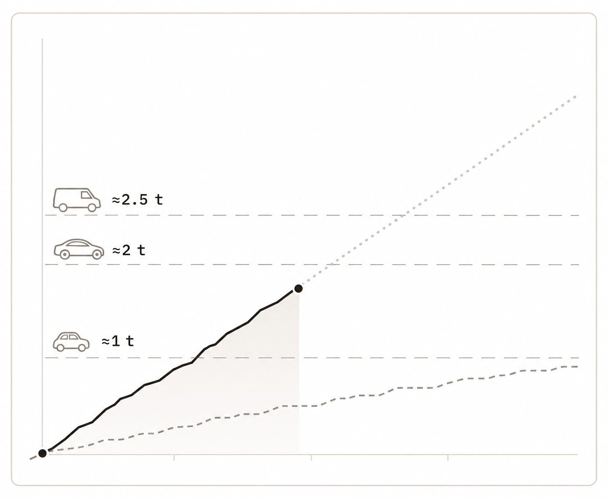

# T-20261103-01 — Vehicle reference lines for Today's tonnage chart

- Status: `planned`; product direction and revised mock approved by the operator.
- Depends on: [PR #1083](https://github.com/Brotherhood-of-Ghisa/BOGA3/pull/1083), merged; no other task dependency.
- Milestone: none; one implementation session, worktree and PR.
- Areas: frontend, product documentation; UI impact: yes.
- Planning baseline: `d6886333` on `origin/main`, 3 November 2026. Verify freshness before implementation.

## Objective

Make cumulative lifted tonnage easier to relate to familiar physical weights by
adding quiet horizontal vehicle reference lines to Today → You → period pace.
Show them only in Tons mode, using the existing data-driven scale followed by a
small top-fit adjustment when necessary. Preserve the existing chart's meaning,
interaction and surrounding layout.

## Approved design target

The operator selected the second design, then removed vehicle descriptions:
**left-aligned outline icon plus approximate tonnage, on thin, widely spaced
dashed horizontal lines**. This revised mock is the accepted build input:

[Open the full-size approved mock](../assets/tonnage-vehicle-lines-approved.png).
This image was generated with built-in ImageGen and refined from the selected
design. It is a component study, approximately 390 × 320 logical points, not a
replacement screen or a runtime screenshot. Its data is illustrative. The wagon
is absent because this example's reach is below 20 t; implementing it is required.

Use the image for stroke language, placement, icon treatment and compact labels.
Use the rules below for eligibility and geometry, and current production code
for dates, metric totals, projection arithmetic, themes, type roles and layout.
Keep the existing Today screen and its adaptive chart height; do not reproduce
the mock as a standalone card, add a new screen or stretch its proportions.
Do not commit the mock into runtime assets or display it as a chart background.

For implementation, load `docs/specs/ui/ai-design-policy.md` and
`docs/specs/08-ux-delivery-standard.md`. The chosen production parent is the
existing `PeriodPace` SVG chart within Today's progress card; this is its bounded
tonnage annotation variant, not a new generic chart or card family. Record that
selection beside the UX Contract in the implementation PR. Report any conflict
with current code or repository policy before silently changing the target.

## Scope

- In: four vehicle milestones, eligibility, shared vertical mapping, minimal
  top headroom, label placement, accessibility, Jest coverage, native visual
  evidence and the owning product fact.
- Out: new settings, milestone customization, achievement storage, animations,
  rewards, notifications, new backend/sync/schema work, metric recalculation,
  changing the projection formula, and adding markers to unrelated charts.
- Preserve Sets-mode geometry, the weekly metric switch and its saved choice,
  selected-day adjustment, comparison navigation, totals and percentage changes.

## Decided — do not reopen without the operator

### Milestones and visible copy

| Internal meaning | Threshold in existing volume units | Visible annotation |
| --- | ---: | --- |
| Small Fiat 500-style car | 1000 | outline icon + `≈1 t` |
| Mercedes-style saloon | 2000 | outline icon + `≈2 t` |
| Panel van | 2500 | outline icon + `≈2.5 t` |
| Empty freight wagon | 20000 | outline icon + `≈20 t` |

These are agreed representative rounded comparisons, not exact manufacturer
specifications. Values remain kg·reps at the calculation boundary: convert to
tonnes for labels only. Compare unrounded values to thresholds. Do not compare
formatted or rounded display strings. Do not show vehicle names, descriptive
sentences, badges, a legend panel or extra explanatory copy on screen.

For provenance when documenting these comparisons, the initial research used
[Fiat specifications](https://www.media.stellantis.com/uk-en/fiat/press/new-fiat-500-uk-pricing-and-specifications-announced),
[Mercedes E-Class data](https://tax.mercedes-benz.co.uk/details/?derivative=E+220+d+AMG+Line+Premium+9G-TRONIC+PLUS&derivative_extra=&make=Mercedes-Benz&model=E-Class+Saloon+New),
[Sprinter data](https://www.mercedes-benz.co.uk/vans/models/sprinter/panel-van/overview.html),
and a [GATX wagon with 19.8 t tare](https://www.gatx.com/products/bogie-container-long-flat-wagon-bll/).
They support approximate classes; the fixed rounded thresholds above are the
product decision. Do not replace 20 t with a loaded wagon's maximum mass.

### Geometry and eligibility — this exact order

1. **Compute the base scale from data.** Start with the same rule as Sets:
   zero baseline; maximum of the current cumulative actuals, current to-date
   total, projected end total, compared cumulative actuals and compared total,
   retaining the existing safe minimum. Reuse the existing metric series and
   null/finite handling. Do not use vehicle weights to choose this base maximum.
2. **Select milestones from actual or projected reach.** Reach is the maximum
   finite known value in this period's current cumulative actuals, its to-date
   total and its projected end total. Include each threshold less than or equal
   to reach. A compared period can stretch the base scale but cannot unlock a
   milestone. A selected past day cannot hide milestones already reached by
   this period; tapping future days cannot change the eligible set either.
3. **Fit the highest eligible annotation.** First position the selected
   milestones on the base scale. If the topmost vehicle outline or its label
   would be clipped or only barely visible, increase the tonnage upper bound
   only enough to fit its full bounding box and a small token-derived clearance.
   Measure in actual chart points, accounting for icon, text and stroke bounds,
   rather than adding an arbitrary percentage to every chart. If it already
   fits, leave the base scale alone. Re-map every data point and milestone with
   the same final scale. Keep zero, day x positions and week ticks unchanged.
4. **Render every eligible milestone.** Headroom is visual padding only: keep
   the selected set from step 2, without selecting again from the expanded
   upper bound. Draw all selected horizontal lines at their exact numeric y
   positions. Do not thin the set, hide lower lines, show only the highest,
   snap to a vehicle maximum or distort the scale to spread small vehicles out.

Scale and membership are stable while scrubbing days. Changing the compared
period may change the base/final scale but not this period's reach. A changed
current window or refreshed data recomputes both. Sets mode uses its original
behavior without vehicle padding or annotations.

When actuals or projection are unavailable, use the remaining known finite
current values. With no usable current actual/projection reach, or reach below
the first milestone, show no vehicle annotations. Previous-only data cannot
create them. Keep existing zero, missing-value and projection semantics.

### Appearance, crowding and accessibility

- Start with approximately 0.75–1 point benchmark strokes and a long spaced
  dash pattern around `12 7`; tune against the approved image at native size.
  Keep existing current, previous and projected series legible and their
  distinct stroke meanings intact. Use semantic neutral roles, existing text
  roles and spacing tokens, adapting to the currently supported themes.
- Use small recognizable side profiles: compact car, longer saloon, van and
  freight wagon. Reuse the vendored icon system or reviewed compatible vector
  geometry, retaining source/license information. Do not install an icon
  package or use emoji, branded logos, per-screen font assemblies or a bitmap
  of the mock. Exact manufacturer detail is unnecessary at this size.
- All selected lines stay at their correct y coordinates. If labels overlap
  on a high-range or short chart, stagger annotation x positions, and if needed
  use a short neutral leader to keep each icon/weight association clear.
  Preserve every eligible line and readable annotation; do not shrink the
  numeric type off-scale. Keep the uncluttered left alignment where it fits.
  This exception is necessary because 1, 2 and 2.5 t cluster near zero when
  the domain is tens or hundreds of tonnes. Prove the chosen treatment on
  the running app; the low-range mock alone does not prove this case.
- Render annotations as a passive layer. Preserve chart touches, hit area,
  day adjustment and comparison actions. Data lines and selection points retain
  visual priority; reference graphics must not obscure them with large opaque
  blocks. Keep full glyph/text bounds inside the chart, including near zero.
- Visible labels contain only icon and approximate tonnes. Expose the vehicle
  meaning and approximate weight through the chart's accessible description
  or an equivalent grouped reading, for example “empty freight wagon,
  approximately 20 tonnes.” Avoid extra focus stops or duplicate icon readings.

## UX contract

| Flow | Trigger and steps | Success | Failure/edge |
| --- | --- | --- | --- |
| Read tonnage | Select Tons in the existing weekly control → derive the current period's reach → show qualifying reference lines | Four possible icon/weight annotations follow the shared chart scale | Below 1 t or no known current reach: none; compared-only milestones remain absent |
| Reach a milestone | Actuals or projection crosses a threshold → select it → fit its annotation → draw all selected lines | Equality includes the threshold; the top icon and label are fully visible | Padding does not unlock the next vehicle; missing projection uses actuals |
| Inspect pace | Touch/adjust past, current or future day; step the compared period | Existing figures, selection and comparison actions work; day scrubbing leaves marker membership and scale stable | A larger comparison changes scale without revealing otherwise unreachable vehicles |
| Return to Sets | Use the same metric switch → render Sets | Original Sets chart, counts and saved preference behavior | No vehicle remnants, added focus stops or tonnage headroom |
| Read a dense/high chart | Render short/small phone and a range reaching the wagon or above | Every eligible line and its icon/weight remains present and associated | Stagger annotations instead of culling; zero and numeric line heights remain truthful |

## Implementation map and sequence

At the planning baseline these are the relevant production owners. Inspect
them again after loading `AGENTS.md` and its area-specific documents:

1. `apps/mobile/components/today/progress-format.ts` owns `periodMetricSeries`,
   `periodChartGeometry`, existing chart bounds and accessibility formatting.
   Keep base-scale, reach, fit and coordinate calculations pure and testable;
   reuse their numeric inputs instead of reconstructing volume in the view.
2. `apps/mobile/components/today/period-pace.tsx` owns the SVG series and measured
   chart size. Add the bounded passive reference layer here or a small feature
   component in the same folder. Avoid a general chart framework.
3. `apps/mobile/components/today/progress-card.tsx` owns the metric selection;
   preserve its behavior. `apps/mobile/components/ui/tokens.ts`,
   `apps/mobile/components/ui/text-roles.ts`, `apps/mobile/components/ui/icon.tsx`
   and `apps/mobile/components/ui/icon-glyphs.ts` own the shared visual vocabulary.
4. Extend `apps/mobile/__tests__/today-progress-format.test.ts` for pure rules,
   and `apps/mobile/__tests__/today-screen.test.tsx` for the production route
   over real data. Before editing tests, load `apps/mobile/__tests__/README.md`;
   before adding async render waits, load `docs/specs/writing-tests.md`.
5. Render and compare the actual native result against the accepted mock, then
   complete the gates, independent code/product review and PR. Keep evidence
   in the PR and gitignored `apps/mobile/artifacts/`, not in this card.

## Required behavior checks

Use deterministic, boundary-focused Jest cases; retain existing Sets tests.

- Thresholds just below, equal to and just above 1000, 2000, 2500 and 20000.
  Rounded display must not unlock a milestone before the raw value reaches it.
- Current actual reach alone; projection alone extending actual reach; a
  lower or absent projection; previous-only high totals; all-zero, missing and
  the boundary's supported non-finite inputs.
- Actual/projected 900 versus compared 30000: a large domain and no vehicles.
- Actual 1200/projected 4200: the first three vehicles, no wagon.
- Actual 19999 with no greater projection: no wagon; actual or projection
  20000: wagon plus all three lower references, with its full annotation fitted.
- Reach exactly 2000: fit the saloon if needed, but never unlock the van even
  if the padded final domain exceeds 2500.
- A highest annotation already fully inside the base scale leaves it unchanged;
  a clipped top annotation gets only the necessary extra room. Padding is
  deterministic/idempotent and all series use the final shared scale.
- Small/short chart geometry, resize, high reach (including roughly 136 t),
  all four annotations, bounded layouts, and no NaN/infinite/inverted positions.
- Past/today/future selection preserves the eligible set and scale; comparison
  stepping preserves eligibility while allowing a new base scale.
- Tons → Sets → Tons keeps normal preference and day/comparison behavior.
  Screen coverage proves visible icon/weight-only labels, appropriate spoken
  descriptions, passive annotations and retained interactive chart actions.

## Native visual acceptance and gates

Expected implementation path default: `./boga test fast` plus
`./boga test frontend-ui` on macOS, or `frontend-android` on Linux.
Re-run `./boga test for` on the implementation diff and agree the final lane
set with the reviewer agent. Select the smallest device lanes exercising the
change; unrelated flows may be lowered only with the documented category,
reason and reviewer agreement. A conditional SVG layer is not automatically
cosmetic. Do not add a committed Maestro flow without the written reason that
Jest cannot prove its device-specific claim.

Capture the running Today screen on small and normal/large phones in at least
these states: below 1 t; the low range matching the mock; exact top-threshold
fit; a range including the wagon; a much higher range with all four lower
references clustered; previous-only high data; missing/zero data; and return to
Sets. Exercise touch/day adjustment and compared-period navigation. Check the
supported light/dark rendering using semantic roles. Compare the reference and
native capture together at matched chart dimensions; record justified deviations.
Show the native result to the operator for visual review; the approved mock is
not acceptance of unrendered production code. Apply the explicit coded-pattern
acceptance checklist if implementation expands into a pattern migration.

Before the implementation PR, run `./boga test jest-coverage`,
`./boga test complexity` and `./boga test dependencies` to green as well as the
agreed gates. No new native dependency/config change is expected; if one becomes
necessary, follow the forced dev-client rebuild rule. Run `./boga doctor` before
claiming any local gate unavailable. Use `./boga timings` for measured durations;
this card does not prescribe estimated runtimes.

## Product facts, documentation and closeout

**Product fact change planned:** add the observable Today tonnage-reference rule
to the comparison subject: fixed approximate milestones, current/projection-only
eligibility, data-first scale, top-fit padding and every eligible line shown.
Before authoring it, load `docs/procedures/product-facts-authoring.md` and
`docs/product/comparison.md`; decide the final fact ID there, and highlight it
on the PR's `Product facts:` line. Preserve the existing tonne exception in
`docs/product/copy.md` (`[[copy.no-weight-unit]]`). Any durable visible-copy change
belongs there rather than in this card. No metric rule or storage version bump
is expected because this is a derived presentation change.

Update the component's behavior comment and tests. Consult
`docs/specs/ui/README.md` before any additional UI-doc update; update
`docs/specs/ui/components-catalog.md` only if the reusable-component or family
ownership actually changes. Do not duplicate this target in a persistent spec.

No product decision remains open. Exact glyph source, stroke tuning, fit
measurements and collision placement are bounded implementation choices.
Escalate a real readability/feasibility conflict with screenshots rather than
silently dropping milestones or changing eligibility.

Execute under the repository's task protocol from a fresh latest-`origin/main`
worktree, checking this card's assumptions first. The current handoff is a
planning commit; land the card/mock through the normal docs-only plan PR before
starting its implementation if they are not yet on `main`. The operator's
approval of this proposal does not authorize merging any PR.

The implementation PR must satisfy the repository's independent code review
and product review, gate evidence, truthful AI attribution and lifecycle rules.
Delete this task card and its companion mock when the feature ships, after
preserving the design/evidence link in the PR and graduating the product rule
to its durable owner. Never cite this card's path or ID from production code,
tests, migrations or persistent docs.
