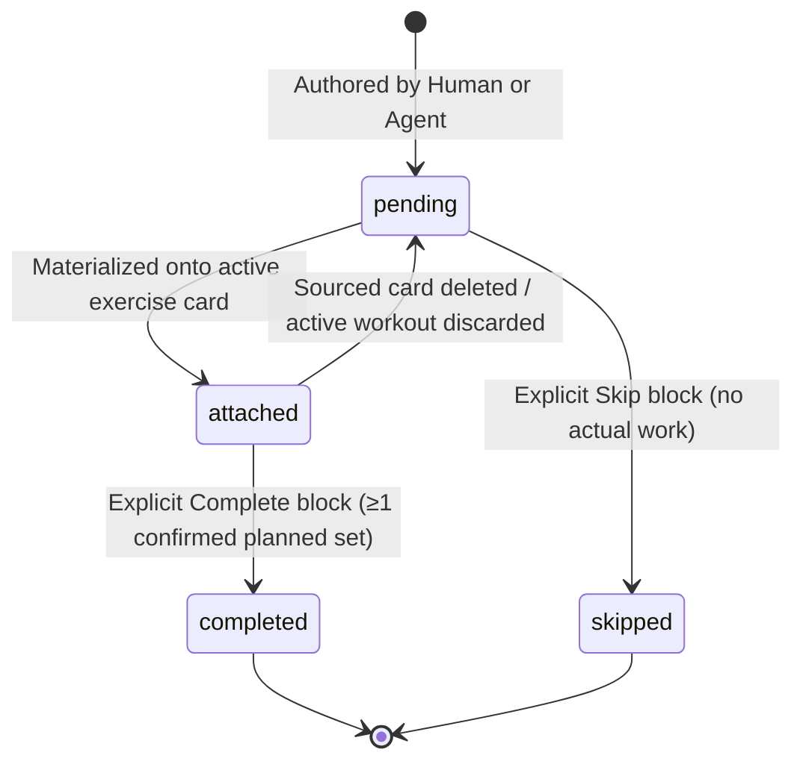

# Session Planning and Programmes Technical Contract

Load when you are building or changing authored plans and programmes: their
schema, the Sync v2 16-entity expansion, materialization onto performed rows,
block lifecycle, or the agent plan-write API and MCP tools.

## 1. Architectural Decisions and Principles

1. **Blueprint vs performed.** Plans and programmes are authored intent, never
   live workout state; `sessions.status` stays strictly `active | completed`.
   Plan and programme rows are excluded from performed history, volume
   analytics, personal records and group activity feeds — only materialized rows
   count, as [[set.performed]] says.
2. **Materialization uses standard entities.** Starting a plan or consuming a
   block creates ordinary `session_exercises` and `exercise_sets` rows. There is
   no recorder "planning mode", so draft and autosave mechanics are unchanged.
3. **The exercise block is the unit of consumption and progress.** A
   `session_plan_exercises` row plus its ordered `session_plan_sets` is
   independently consumable: a user can attach one block (e.g. the squat block of
   a 6-week wave) to an active session, perform unrelated freeform exercises, and
   explicitly resolve only that block.
4. **Deterministic provenance and partial uniqueness.** Performed rows link back
   to source plan rows via nullable FKs (§2.2), and partial unique indexes allow
   at most one live performed session per whole-plan start, one live card per plan
   block, and one live set per plan target set — so retries, multi-device sync and
   concurrent attachments converge deterministically (§4.5).
5. **Agent permissions are separate and opt-in.** The base OAuth grant is
   strictly read-only. Coaching agents read upcoming plans, create new
   plans/programmes and edit exercises under explicit per-client permission in
   `public.agent_plan_permissions` (`plan_access_enabled = true`). Mutating
   authored plans or programmes requires separate `plan_edit_enabled = true`
   permission (§6.1). Agents mutate pending, unattached blocks under optimistic
   graph version tokens; they can never touch performed rows or advance workout lifecycle.
6. **Exhaustive coaching reads.** Coaching history reads drain qualifying history
   via stable keyset cursors to exhaustion. Silent row caps and unpaginated
   truncation are prohibited.

## 2. Data Model and Schema

### 2.1 Synced Entity Tables (Sync v2)

Four entities, all user-owned, composite-keyed `(owner_user_id, id)` with ULID
`id`, carrying standard Sync v2 server fields plus client
`createdAt` / `updatedAt` / `deletedAt` epoch-ms columns; foreign keys are
`DEFERRABLE INITIALLY DEFERRED`.
Every composite FK below is `(owner_user_id, <col>) -> <parent>(owner_user_id,
id)`; camelCase ↔ snake_case mapping follows `apps/mobile/src/data/schema/`.

**`training_programmes`** — an ordered collection of planned sessions (a 6-week
wave, a split): `name` required 1..100 chars, `description` nullable max 500,
`last_modified_by` `'human' | 'agent'`, default `'human'`.

**`session_plans`** — one authored future session, standalone or in a programme.

- `programme_id` — nullable FK → `training_programmes`, `ON DELETE SET NULL`
- `programme_order_index` — nullable, 0-based order within the programme
- `gym_id` — nullable FK → `gyms`, `ON DELETE SET NULL`
- `title` — required, 1..100 chars
- `scheduled_for` — nullable epoch ms; null means the unscheduled queue
- `provenance` — `'human' | 'agent'`, default `'human'`
- `last_modified_by` — `'human' | 'agent'`, default `'human'`

**`session_plan_exercises`** — an ordered, independently consumable block.

- `session_plan_id` — FK → `session_plans`, `ON DELETE CASCADE`
- `exercise_definition_id` — nullable FK → `exercise_definitions`,
  `ON DELETE SET NULL`
- `order_index` — 0-based dense sequence within the plan
- `name` — exercise name snapshot; required 1..100 chars
- `progress_status` — `'pending' | 'completed' | 'skipped'`, default
  `'pending'`, `CHECK`-constrained
- `resolved_at` — nullable;
  `CHECK (resolved_at IS NULL OR progress_status IN ('completed','skipped'))`
- `last_modified_by` — `'human' | 'agent'`, default `'human'`

**`session_plan_sets`** — an ordered target set for a planned block.

- `session_plan_exercise_id` — FK → `session_plan_exercises`,
  `ON DELETE CASCADE`
- `order_index` — 0-based dense sequence within the block
- `target_weight_value` — nullable non-negative numeric text in kg; null means
  "choose during workout"
- `target_reps` — required positive integer, `CHECK (target_reps > 0)`
- `target_set_type` — nullable standard set type (`'warm_up'`,
  `'rir_1'`, …)
- `last_modified_by` — `'human' | 'agent'`, default `'human'`

### 2.2 Performed-Domain Provenance Fields

Three nullable `text` columns added to the existing performed tables. Each is a
composite FK `ON DELETE SET NULL DEFERRABLE INITIALLY DEFERRED`, guarded by a
partial unique index on `(owner_user_id, <col>) WHERE deleted_at IS NULL AND
<col> IS NOT NULL`.

| Column | Parent | Partial unique index | Null when |
| :--- | :--- | :--- | :--- |
| `sessions.source_plan_id` | `session_plans` | `sessions_owner_source_plan_unique` | set only on whole-plan starts (`startSessionPlan`); null for manual sessions and single-block attachment |
| `session_exercises.source_plan_exercise_id` | `session_plan_exercises` | `session_exercises_owner_source_block_unique` | unsourced/manual cards |
| `exercise_sets.source_plan_set_id` | `session_plan_sets` | `exercise_sets_owner_source_set_unique` | manual sets, e.g. warm-ups |

#### Cross-Level Provenance Invariant

A performed set with `source_plan_set_id IS NOT NULL` is valid **if and only
if** its parent `session_exercises` row has `source_plan_exercise_id` matching
that plan set's parent `session_plan_exercise_id`.

- An unsourced exercise card cannot contain source-derived sets.
- A sourced card may mix matching source-derived sets with null-linked manual
  sets (warm-ups, drop sets).
- Server sync push triggers and local transactions reject cross-level mismatches
  atomically.
- These indexes also arbitrate concurrent attachments of the same block (§4.5):
  the first committed attachment wins, the loser reverts deterministically.

### 2.3 Non-Sync Control Tables

Neither table is a synced entity.

**`public.agent_plan_permissions`** — one row per connected coaching client,
PK `(owner_user_id, client_id)`, `plan_access_enabled boolean not null default
false`, `plan_edit_enabled boolean not null default false`, `granted_at timestamptz not null`, created/updated timestamps.

- Direct table access only for authenticated users where
  `auth.uid() = owner_user_id` **and** `(auth.jwt() ->> 'client_id') IS NULL` —
  the app, never an agent. `anon` and OAuth client bearer tokens are denied by
  RLS.
- A missing row, or `granted_at` not matching the live OAuth token's grant
  timestamp, yields `403 PLAN_PERMISSION_REQUIRED`. Mutating plans/programmes
  requires `plan_edit_enabled = true` (`403 PLAN_EDIT_PERMISSION_REQUIRED`).

**`public.agent_plan_write_receipts`** — makes agent writes idempotent (§6.1).
PK `(owner_user_id, client_id, operation, idempotency_key)`, with
`payload_sha256 text`, `result_ids jsonb`, `created_at`.

- RLS enabled with no client policies: service-role only.
- Stores no workout or training payload — only the SHA-256 payload hash and the
  emitted entity IDs.

## 3. Sync v2 Topology and Layer Migration

Sync v2 expands from **twelve to sixteen** user-owned entity types.

### 3.1 Five-Layer Topological Order (`TOPO_LAYERS`)

The live layering, the invariants it must satisfy, and the rule for adding an
entity (add it to its correct layer **and** add the matching
`app_public.<entity>` migration) live in `apps/mobile/src/sync/topo-order.ts`;
the drift checker (`apps/mobile/scripts/check-sync-schema-drift.ts`) fails the
slow gate when the two diverge. The layering exists because the push batch
builder walks layers in order and relies on it for FK-safe send order without
per-row sorting.

The four new entities land as:

| Layer | Added entity | FKs to earlier layers |
| :--- | :--- | :--- |
| 0 | `training_programmes` | none |
| 1 | `session_plans` | `gyms`, `training_programmes` |
| 2 | `session_plan_exercises` | `exercise_definitions`, `session_plans` |
| 3 | `session_plan_sets` | `session_plan_exercises` |

That pushes the performed chain down one layer each — `sessions` 1→2,
`session_exercises` 2→3, `exercise_sets` 3→4 — while
`body_weight_measurements` stays alone in Layer 4 as an independently cursorable
private root.

### 3.2 Pull Cursor Reset and Protocol-4 Gate

Client cursors live in `sync_runtime_state.pull_cursor` keyed by layer integer;
the reshuffle invalidates stored cursors. Cursor remapping is rejected: shifting
can orphan children or skip blocks.

- **Client.** Local SQLite migration to the 16-entity schema resets `pull_cursor`
  to `{}` so sync re-drains each layer from the start; replayed rows upsert as
  idempotent LWW merges.
- **Server.** The projection shift is gated on header `x-boga-sync-protocol: 4`.
  Older clients halt with `UPDATE_REQUIRED`, preventing cursor corruption.

**As-built.** Migrations `0016_nice_blink` (schema) and `0017_session_plan_cursor_reset`
(reset); `require_sync_protocol()` enforces protocol 4.

## 4. Lifecycle and Materialization

### 4.1 Plan Block Lifecycle

- **Pending:** available for use; eligible unattached blocks stay fully editable.
- **Attached:** materialized onto an active session card, and read-only.
- **Completed:** [[planner.block-completion]] requires explicit user completion
  or automatic completion on finishing the active session with ≥1 confirmed
  source-derived set (`source_plan_set_id IS NOT NULL`). Manual warm-ups alone
  cannot complete a block; target deviations do not prevent completion. On read,
  a pending block claimed by a completed session derives `completed` when it has
  confirmed source-derived work.
- **Skipped:** explicitly skipped from programme detail (no performed rows).
- **Derived progress:** parent progress (`planned | in_progress | completed`)
  is computed on the fly from child block states, never stored.

### 4.2 Start All (`startSessionPlan`)

1. **Active check.** An existing active session (`status = 'active' AND
   deleted_at IS NULL`) returns typed `ACTIVE_SESSION_CONFLICT`; the UI routes to
   **Resume Active Session** and never replaces or auto-completes it.
2. **One local transaction.** With no qualifying block, return typed
   `NO_PENDING_BLOCKS` and create nothing. Otherwise create the `sessions` row
   (`source_plan_id = plan.id`, `gym_id = plan.gym_id`, `status = 'active'`),
   then per eligible pending block create a `session_exercises` row
   (`source_plan_exercise_id`, snapshots), and per non-deleted plan set an
   `exercise_sets` row with `source_plan_set_id`, targets copied to planned
   columns, blank actuals, and `performance_status = 'planned'`.
   Completed and skipped blocks are never re-materialized.
3. **Deterministic IDs.** Reuse the deterministic text-ID pattern
   (`exerciseGroupLinkId` in `apps/mobile/src/data/exercise-group-links.ts`),
   composed from owner and source ID — `` `${ownerId}:${plan.id}:start` ``,
   `` `${ownerId}:${plan_exercise.id}:start` ``,
   `` `${ownerId}:${plan_set.id}:start` `` — so a retry on the same plan returns
   the existing active session instead of duplicating rows.

### 4.3 Add Plan Block (`addPlanBlockToSession`)

Appends one planned block to an active session, or starts one if none exists.

1. **Session resolution.** With no active session, create one using
   `plan.gym_id`; otherwise use the active session (its `source_plan_id` stays
   null if it was started manually).
2. **Card matching.** A *compatible* card is an unsourced card
   (`source_plan_exercise_id IS NULL`) referencing the same non-null
   `exercise_definition_id`.
   - **A — explicit target:** a valid `targetSessionExerciseId` attaches there.
   - **B — single match:** exactly one compatible card attaches automatically.
   - **C — ambiguity:** two or more return typed `AMBIGUOUS_COMPATIBLE_CARDS`
     with the candidate card IDs and write nothing until the user selects.
   - **D — no match:** create a new `session_exercises` row with
     `source_plan_exercise_id = planExercise.id`.
3. **Set materialization.** Planned sets take the next dense sequence after the
   card's existing sets (`order_index = existingSetCount +
   plan_set.order_index`), so manual warm-ups remain above planned sets by
   default. Each set sets `source_plan_set_id` and
   `performance_status = 'planned'`.

### 4.5 Provenance Arbitration for Concurrent Attachments

Two offline devices can attach the same block to two different unsourced cards
(§4.3 cases B–D). The cards keep their own IDs, so per-row LWW cannot reconcile
them; the §2.2 partial unique indexes are the arbiter, and the loser's repair
path is defined so the permitted operation can never block sync.

1. **Server arbitration.** `sync_push` is atomic per batch (single ack, no
   per-row outcomes), so when a batch would create a second live provenance row
   for the same `(owner_user_id, source_plan_exercise_id)` on
   `session_exercises` — or the same `source_plan_set_id` on `exercise_sets` —
   the whole batch fails with typed `BLOCK_ALREADY_ATTACHED` carrying the winning
   card ID. Server commit order is the only tiebreak.
2. **Loser repair (deterministic).** On `BLOCK_ALREADY_ATTACHED` the client
   pulls, clears `source_plan_exercise_id` on its losing card and
   `source_plan_set_id` on that card's source-derived sets, and re-pushes.
   Entered actuals and manual sets are preserved; the card returns to
   unsourced, keeping the Cross-Level Provenance Invariant intact.
3. **Convergence.** Every device ends with one live card carrying the
   provenance link; the losing card keeps all user work as unsourced rows.
   Whole-plan starts need no arbitration: deterministic IDs (§4.2) make a
   competing Start all resolve to the same row.

### 4.6 As-built: mobile module map and deviations

- **Boundary.** Plan-table SQL lives in `apps/mobile/src/data/session-plan-store.ts`
  (graph save, meta updates, block rewrite, tombstones, reorders); performed writes
  stay in `session-drafts.ts`. `apps/mobile/src/session-planner/` owns screen-facing
  APIs: types, validation, deterministic IDs, plan repository, read models, lifecycle
  actions (`startSessionPlan`, `addPlanBlockToSession`, `completePlanBlock`, `skipPlanBlock`).
- **Deterministic IDs.** `` `${ownerId}:${sourceId}:start` `` per §4.2; signed-out
  devices use owner `local`.
- **Available block.** Pending, definition-bearing, and unclaimed by an active/completed card.
- **Add block.** Session ID uses a fresh local ID with null `source_plan_id`; retries reuse
  the active session.
- **Arbitration.** Token message carries the failed constraint name. Repair clears local
  claimants of the pulled claims and re-pushes.
- **Mobile training programmes.** `programme-form-model.ts` validates draft graphs (>=2 plans).
  Authoring (`/programme/new`) edits sessions via `ProgrammeSessionEditSheet`. Detail
  (`/programme/[programmeId]`, `useProgrammeDetail.ts`) surfaces `nextBlock`, attaches blocks,
  and skips blocks. Reordering updates `programme_order_index`. Delete soft-deletes the programme
  and detaches child plans (`programme_id = null`) as standalone plans.

## 5. UI and UX Contracts

### 5.1 Route and Screen Map

| Route | Contract |
| :--- | :--- |
| `/sessions` (Planning Hub) | Four sections — **Active**, **Upcoming** (scheduled plans by date), **Unscheduled** (plans and programmes by updated time), **Completed** (performed history). Queue management and authoring live here; screen rules in `docs/specs/ui/screen-map.md`. |
| `/session-plan/new` | Author a one-off plan (also edit and duplicate prefill); target entry follows the recorder through shared fields. |
| `/session-plan/[planId]` | View/edit: Start all, Duplicate, Delete (unused/eligible only), Add block. Consumed blocks are read-only and link to their performed session. |
| `/programme/new` | Author an ordered programme; minimum 2 child plans; target entry uses the recorder's shared fields. |
| `/programme/[programmeId]` | Overall progress, next unresolved block in sequence, child plan summaries. |

- **Today tab:** surfaces the next scheduled workout or programme block as a primary Start card.
- **Exercise picker:** the historical **Append plan** action is renamed **Repeat
  last**, and a new **Planner** chip selects available authored blocks.

Planner **Add set(s)** opens a count-only form, default 1. It appends that
many exact copies of the last target, preserving weight, reps and effort,
with fresh IDs. Existing targets retain their values and order. Over-limit
requests refuse atomically. Programme children share this form.

## 6. Agent API and MCP Tools

### 6.1 Agent API Routes (`supabase/functions/agent-api/`)

All agent routes enforce strict token validation, current-grant checks against
`public.agent_plan_permissions`, and service-role isolation. Read routes need only
the base grant; creation routes require `plan_access_enabled = true`; mutation routes
require `plan_edit_enabled = true`.

| Route | Method | Purpose |
| :--- | :--- | :--- |
| `/v1/agent/session-plans` | `GET` | paginated plans with graph-wide `version` |
| `/v1/agent/session-plans` | `POST` | create one plan graph (pending blocks only) |
| `/v1/agent/session-plans/:planId` | `PATCH` | mutate plan graph (`base_version` check) |
| `/v1/agent/programmes` | `POST` | create one programme graph (pending blocks only) |
| `/v1/agent/programmes/:programmeId` | `GET` | programme detail with graph `version` |
| `/v1/agent/programmes/:programmeId` | `PATCH` | mutate programme graph (`base_version` check) |
| `/v1/agent/exercises/:exerciseId/history` | `GET` | exhaustive keyset-paginated performed set history |
| `/v1/agent/workouts/:sessionId` | `GET` | exact completed workout header and paginated sets |

- **Idempotency.** `POST` and `PATCH` routes require an `idempotency_key` header.
  Replaying the same key and payload returns the original result IDs from
  `public.agent_plan_write_receipts`; same key with differing payload returns
  `409 IDEMPOTENCY_CONFLICT`.
- **Optimistic concurrency.** Editable reads (`session-plans` GET, `programmes/:id` GET)
  return graph `version` (maximum `server_received_at` across root plan, blocks, and sets).
  Mutations supply `base_version`; mismatches abort with `409 PLAN_CONCURRENT_MODIFICATION`.
- **Safety boundary.** Agents mutate pending, unattached blocks only. Attached or
  resolved blocks reject with `400 IMMUTABLE_BLOCK_MUTATION`. Performed rows are never touched.
- **Monotonic timestamps.** Every mutated or tombstoned row advances
  `client_updated_at_ms = greatest(stored + 1, now_ms)` and stamps `last_modified_by = 'agent'`.
- **Store-mirroring mutations.** Operations mirror mobile store operations (meta updates,
  block adds/edits/reorders, set reorders, soft tombstones, programme plan detaches). Structural
  limits (>=1 block per plan, >=2 plans per programme) reject with `400 INVALID_ARGUMENT`.
- **Exhaustive history.** Keyset cursors drain qualifying history database-side without truncation.

### 6.2 MCP Tool Surface (`services/boga-mcp/`)

The planning tools below; `services/boga-mcp/README.md` lists every tool.
Eight read-only: `get_training_profile`, `search_exercises`, `get_exercise_context`,
`get_recent_workouts`, `get_exercise_history`, `get_workout_detail`,
`get_upcoming_session_plans`, `get_programme_detail` (reads include graph `version`).

Two create-only (`readOnlyHint: false`, `idempotentHint: true`, `destructiveHint: false`),
requiring `plan_access_enabled`: `create_session_plan`, `create_training_programme`.

Eleven edit tools requiring `plan_edit_enabled`:
- Meta and reorder (`destructiveHint: false`): `update_plan_meta`, `update_programme_meta`,
  `insert_plan_block`, `update_plan_block`, `reorder_plan_blocks`, `reorder_programme_plans`,
  `reorder_block_sets`.
- Destructive (`destructiveHint: true`): `remove_plan_block`, `detach_plan_from_programme`,
  `remove_plan`, `remove_programme`.

## 7. Error Tokens and Validation Limits

### 7.1 Field and Graph Limits

- `title` / `name`: 1..100 characters; `description`: 0..500.
- 2..50 plans per programme; 1..30 blocks per plan; 1..30 sets per block.
- `target_reps`: integer 1..999. `target_weight_value`: decimal text 0..9999.99 kg, or null.
- `idempotency_key`: 1..128 characters.

### 7.2 Stable Error Codes

Wire-stable — part of the agent API and MCP contract, never renamed.

- `PLAN_PERMISSION_REQUIRED` (403) — no active plan permission in `agent_plan_permissions`.
- `PLAN_EDIT_PERMISSION_REQUIRED` (403) — client lacks active `plan_edit_enabled` permission.
- `ACTIVE_SESSION_CONFLICT` (409) — Start all while another session is active.
- `AMBIGUOUS_COMPATIBLE_CARDS` (409) — multiple compatible unsourced cards; selection required.
- `NO_PENDING_BLOCKS` (409) — Start all with no eligible pending block (§4.2).
- `BLOCK_ALREADY_ATTACHED` (409) — concurrent attachment of the same block; server arbitrated, loser reverts (§4.5).
- `PLAN_CONCURRENT_MODIFICATION` (409) — graph version changed since read.
- `IDEMPOTENCY_CONFLICT` (409) — same idempotency key, different payload.
- `FOREIGN_RESOURCE_REFERENCE` (400) — referenced exercise, gym or plan is not the user's.
- `INVALID_ARGUMENT` (400) — structural graph violation (<1 block in plan, <2 plans in programme).
- `INVALID_BLOCK_RESOLUTION` (400) — completing a block without a confirmed planned set.
- `IMMUTABLE_BLOCK_MUTATION` (400) — modifying or deleting an already attached or resolved block.
